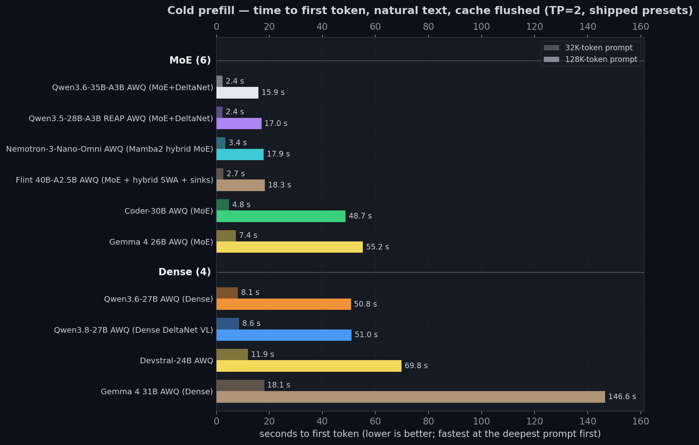

# NVIDIA Inference: SGLang on 2x RTX 3090

Single-user, **256K-context** LLM inference on 2× NVIDIA RTX 3090 (GA102, Ampere, 48 GB total): SGLang
**v0.5.23** + 43 local patches, CUDA 13.2 / PyTorch cu130, every model an **AWQ-int4 ship calibrated
in-house** from the upstream BF16 base. This rig owns all evals and the AWQ/INT4 calibrations; FP8 work
lives with the [R9700 RDNA4 stack](https://github.com/mattbucci/2x-R9700-RDNA4-GFX1201-sglang-inference).

We optimise for 256K-context single-user agentic workloads: decode tok/s and TPOT at depth first,
multi-user throughput second and never bought with single-user latency. SWE-bench Lite is the canonical
eval, so every preset serves at full 256K (or the model-card max). What this rules out and why:
[`docs/direction.md`](docs/direction.md).

Open work and known issues are tracked in
[GitHub issues](https://github.com/mattbucci/2x-3090-GA102-300-A1-sglang-inference/issues).
Long-form material lives in [`docs/`](docs/): [decode levers](docs/decode-levers.md) ·
[models and KV limits](docs/models.md) · [SWE-bench harness](docs/swebench-bakeoff.md) ·
[quality evals](docs/quality-evals.md) · [Flint](docs/flint.md) · [calibration plan](docs/roadmap.md) ·
[host setup](docs/host-setup.md) · [OCI image](docs/oci-image.md) · [agent operations](docs/agent-operations.md).
Per-patch narratives: [`patches/README.md`](patches/README.md).

## Results

- **Decode at a true 256K window:** `qwen36-ream` **187 tok/s**, `qwen35-moe` 186, `qwen36` 148, `flint` 115.
- **Cold prefill at 131K:** `qwen36` 15.9 s, `flint` 18.3 s; a cached 1-token turn at 197K: 70–85 ms.
- **SWE-bench Lite:** `qwen38` 65.3 %, `qwopus38` 63.3 %, `flint` 60.7 %; scaffolds tie within noise.

### Single-user decode across the fleet


Charts: `scripts/bench/generate_charts.py` (fleet style shared with R9700).
Every deep point is server-verified at its labeled depth (`actual_input_tokens`; the deepest honest point is
255K = 262144 − output − margin), single-user, fresh prefill, at each model's real KV pool. Receipts:
`benchmarks/<preset>/results.json`, the lever ledger in [`docs/decode-levers.md`](docs/decode-levers.md).

- **True-256K decoders:** the A3B DeltaNet MoEs lead (`qwen36-ream` **187 tok/s @255K**, `qwen35-moe` 186,
  `qwen36` 148; ~286 short); the Mamba2-hybrid `nemotron3-omni` is near-flat (101 → 95); the 30B-A3B coder
  trio sits at ~78 @255K; the dense DeltaNet 27Bs (`qwen36-dense`, `qwen38`) at 58; on the triton backend
  `flint` **115**, the Gemma 4 MoEs 64–65, `gemma4-31b` 33.
- **Expert pruning or merging does not speed M=1 decode**; REAP/REAM win on KV headroom and footprint.
- **The dense DeltaNet presets sit at the GA102 memory roofline**; the A3B MoEs carry a 14 % idle gap that
  is kernel count, not bandwidth ([issue #13](https://github.com/mattbucci/2x-3090-GA102-300-A1-sglang-inference/issues/13)).
- **Power:** the 300 W cap costs 0–5 % against 400 W; weight-streaming decode saturates near 320 W
  ([sweep](benchmarks/power-sweep-2026-10-24/)).


#### Speculative decoding


DSpark on `qwen38` holds **1.21× at 250K actual** with the true 256K window (fp8 KV; 1.95× / 1.34× /
1.21× / 1.11× at 1K / 32K / 131K / 262K) and serves its bake-off cycle (`SPEC_DECODE=1`). Other drafts
collapse at depth ([ledger](docs/decode-levers.md#speculative-decoding)); data `benchmarks/specdec-comparison.json`.

### Agentic follow-up turns and prefill



A chat-API follow-up turn re-sends the whole conversation; the server now re-encodes only the tail
(patch 072), routes short cache-hit extends through a split-KV kernel on the triton presets (patch 070,
up to 128 new tokens once the cached prefix is ≥ 32K) and replays a CUDA graph for 8–128-token extends
on the flashinfer presets, with Mamba-state tracking on `nemotron3-omni` (patch 074).

| Turn at 197K cached prefix | `flint` | `qwen38` | `gemma4-31b` | `nemotron3-omni` |
|---|:--:|:--:|:--:|:--:|
| 1 new token | 85 ms | 72 ms | 82 ms | 70–79 ms |
| 64 new tokens | 104 ms | — | 270 ms | 75–98 ms |

Cold prefill: W4A8 (patch 071, per-token INT8 activations through the unlocked INT8 tensor path) is the
default on `qwen38` (**8.6 s @32K, 51 s @131K, 145 s @262K**), `qwen36-dense`, `gemma4-31b`,
`qwen35-moe` and `qwen36`; `devstral` is excluded because its long-prompt reasoning collapses under it.
Its INT8 path moves greedy outputs in about half of the cache-hit cells (up to 2.8 nats; fp16 stays within
0.1), invisible to the single-turn gates; agentic cost is [issue #20](https://github.com/mattbucci/2x-3090-GA102-300-A1-sglang-inference/issues/20),
off switch `SGLANG_AWQ_W4A8_PREFILL_MIN_TOKENS=1000000000` ([receipt](benchmarks/quality/cache-hit-w4a8-2026-11-02.md)).
The triton presets are bound by the extend-attention kernel
([issue #12](https://github.com/mattbucci/2x-3090-GA102-300-A1-sglang-inference/issues/12)); `flint` ships a
128×128 tile, the bf16 softmax·V dot (patch 075) and flashinfer paged prefill on
full-attention layers (080): cold fill **2.7 s @32K, 18.3 s @131K, 50 s @250K**
([receipt](benchmarks/profiling/prefill-flashinfer-route-2026-11-11/README.md)).
Receipts: [`benchmarks/profiling/multiturn-cache-2026-11-01/`](benchmarks/profiling/multiturn-cache-2026-11-01/README.md),
[`benchmarks/fleet-w4a8-2026-11-01/`](benchmarks/fleet-w4a8-2026-11-01/README.md).

### SWE-bench Lite (isolated Docker harness)


Full 300 instances, one attempt each, single-user, `swebench==4.1.0` scorer, one lane per preset (`omp`, oh-my-pi); every counted cell ran at the served 262K window with template-default thinking, a 32K output
budget, no network, and closed on the
leak audit at 0 exposed. **Only full-300 cells are compared.** Mechanics and receipts:
[`docs/swebench-bakeoff.md`](docs/swebench-bakeoff.md); queue (remaining presets on `omp`) in
[issue #11](https://github.com/mattbucci/2x-3090-GA102-300-A1-sglang-inference/issues/11).

| Preset | resolved/300 (opencode unless marked `omp`) |
|--------|:--------:|
| `qwen38` (Qwen3.8-27B AWQ, thinking) | **196/300 (65.3 %)** |
| `qwopus38` (Qwopus3.8-27B-Coder-Flash AWQ) | `omp` **190/300 (63.3 %)** (tie with `qwen38`, p = 0.45) |
| `qwen36-dense` (Qwen3.6-27B Dense AWQ, thinking) | **191/300 (63.7 %)** |
| `flint` (Flint 40B-A2.5B, calibrated AWQ, thinking) | **182/300 (60.7 %)** · `omp` **186** · v5 176 (ties) |
| `qwen36` (Qwen3.6-35B-A3B AWQ-Marlin, thinking) | **176/300 (58.7 %)** |

The lanes are within noise of each other (the `qwen38` five-scaffold bake-off, `flint` opencode 182 vs `omp` 186,
`qwopus38` `omp` 190 vs `qwen38` opencode 196: all McNemar ties, [detail](docs/swebench-bakeoff.md)); `omp` is
the default lane as the cheapest. `qwen3-ream` is excluded on model grounds
([verdict](benchmarks/quality/bakeoff-qwen3-ream-verdict-2026-07-17.md)).

### Quality

Every shipped AWQ model is scale-integrity clean (`check_awq_scales.py --base`) and passes every applicable
capability probe (thinking / image / video / audio / tool) on the current stack. Static evals, the 256K
tool-use ladder and the 256K reasoning probe with footnotes: [`docs/quality-evals.md`](docs/quality-evals.md).

| Preset | MMLU | HumanEval | Needle | 256K tool-use (max true tokens correct) | 256K reasoning |
|---|:--:|:--:|:--:|:--:|:--:|
| `qwen36-dense` | **98.2 %** | **97.5 %** | ✓ 250K | 1.0 → 258K | 100 % |
| `qwen36` / `qwen36-ream` | 93.0 / 84.2 % | **97.5 %** | ✓ 250K | 1.0 → 255,889 | 100 % |
| `qwen38` | **93 %** | **96 %** | ✓ 250K | DSpark cell, 196/300 SWE-bench | — |
| `qwopus38` | 87.7 % | **100 %** | ✓ 250K | caps 5/5, 190/300 SWE-bench (omp) | **100 %** |
| `gemma4-31b` | 93.0 % | **97.5 %** | ✓ 250K | 1.0 → 258K | **100 %** |
| `gemma4` / `gemma4-21b-reap` / `gemma4-12b` | 82.5 / 80.7 / 77.2 % | 97.5 / 0 † / 92.5 % | ✓ 250K | 1.0 → 255,957 / 258K / 258K | 94 / 94 / 61 % |
| `qwen35-moe` | 69.6 % | 80.0 % | ✓ | 1.0 → 255,889 | 72 % (multikey soft ≥ 131K) |
| `flint` | 86–88 % | 73–80 % | ✓ 244K @ ≥ 0.5 natural ◆◆ | 1.0 → 234,430 on a natural haystack | see ◆◆ |
| `devstral` | 77.2 % | 80.0 % | ✓ 131K | 1.0 → 132K firm | ~80 % at 178K |
| `coder-30b-eval` / `coder-reap-25b` | 91.2 / 77.2 % | **96.7 %** | 100 % | 0.4 (~64K agentic ceiling) | — |
| `nemotron3-omni` | — | — | — | 0.6 → 131K at an 8K budget | — |
| `qwen3-ream` | 80.7 % | 27.5 % ◊ | ✓ 250K | 148K single-turn only | 100 % at 178K |

† REAP prune lost coding. ◆ 57-question chat-mode MMLU under a 200-token cap on a thinking model.
◆◆ natural Open-Platypus haystack; the stock filler is a repetition attractor on Flint's NoPE layers, so
retrieval and reasoning probes on Flint use `--haystack` ([issue #7](https://github.com/mattbucci/2x-3090-GA102-300-A1-sglang-inference/issues/7)).
◊ non-coder text generalist on a code task. The flagship MoE thinkers and the Gemma 4s hold perfect
tool-calling at true 256K at every needle depth; the Coder-30B family does not, so agentic work beyond
~64K goes to the Qwen3.6 family.

## Presets

`scripts/launch.sh` is the source of truth; every preset defaults to TP=2 and its full context,
`--max-running 1`, an explicit `--tool-call-parser` matching its chat template (Qwen3-Coder + Qwen3.5/3.6/3.8
→ `qwen3_coder`; Qwen3-VL / Qwen3-30B REAM → `qwen25`; Devstral → `mistral`; Gemma 4 → `gemma4`),
`--sampling-defaults model` on thinking presets, and the levers above where they gate clean. tok/s =
single-user at 32K and at the deepest point. Full table, HuggingFace zoo, MoE coverage and KV limits:
[`docs/models.md`](docs/models.md).

| Preset | Model | Type | Ctx | tok/s 32K → deep | HF |
|---|---|---|:--:|:--:|---|
| `qwen36-ream` | Qwen3.6-REAM-A3B AWQ | DeltaNet+MoE A3B (192 exp, VL) | 262K | 260 → **187** | [link](https://huggingface.co/mattbucci/Qwen3.6-REAM-A3B-AWQ) |
| `qwen35-moe` | Qwen3.5-28B-A3B-REAP AWQ | DeltaNet+MoE A3B (205 exp, VL) | 262K | 258 → **186** | [link](https://huggingface.co/mattbucci/Qwen3.5-28B-A3B-REAP-AWQ) |
| `qwen36` | Qwen3.6-35B-A3B AWQ-Marlin | DeltaNet+MoE A3B (256 exp, VL) | 262K | 248 → **148** | [link](https://huggingface.co/mattbucci/Qwen3.6-35B-A3B-AWQ) |
| `flint` | Flint 40B-A2.5B AWQ (calibrated g32) | MoE A2.5B, 35 SWA + 14 NoPE layers, learned sinks, thinking + tools | 262K | 170 → **115** | [link](https://huggingface.co/mattbucci/Flint-AWQ-g32) |
| `nemotron3-omni` | Nemotron-3-Nano-Omni-30B-A3B AWQ | Mamba2-hybrid MoE A3B (AVLM, 6/6 caps, `moe_wna16`) | 262K | 100 → **95** | [link](https://huggingface.co/mattbucci/Nemotron-3-Nano-Omni-30B-A3B-Reasoning-AWQ) |
| `coder-30b` / `coder-30b-eval` | Qwen3-Coder-30B-A3B AWQ (CT) | MoE A3B (128 exp) | 262K | 191 → **79** | [link](https://huggingface.co/mattbucci/Qwen3-Coder-30B-A3B-AWQ) |
| `coder-reap-25b` | Qwen3-Coder-30B-A3B-REAP AWQ | MoE A3B (96 exp) | 262K | 189 → **78** | [link](https://huggingface.co/mattbucci/Qwen3-Coder-30B-A3B-REAP-AWQ) |
| `qwen3-ream` | Qwen3-30B-Instruct-2507 REAM AWQ | MoE A3B (96 exp, text) | 262K | 189 → **78** | [link](https://huggingface.co/mattbucci/Qwen3-30B-Instruct-2507-REAM-AWQ) |
| `gemma4` | Gemma 4 26B A4B MoE AWQ | MoE A4B (103 exp, VL + video + audio) | 262K | 86 → **64** | [link](https://huggingface.co/mattbucci/gemma-4-26B-AWQ) |
| `gemma4-21b-reap` | Gemma 4 21B REAP AWQ | MoE (VL; HumanEval 0, vision/chat ship) | 262K | 86 → **65** | [link](https://huggingface.co/mattbucci/gemma-4-21B-REAP-AWQ) |
| `gemma4-12b` | Gemma 4 12B Unified AWQ | omni, encoder-free (5/5) | 262K | 106 → **65** | [link](https://huggingface.co/mattbucci/gemma-4-12B-AWQ) |
| `gemma4-31b` | Gemma 4 31B Dense AWQ | dense (VL), fp8_e5m2 KV, triton | 262K | 55 → **33** | [link](https://huggingface.co/mattbucci/gemma-4-31B-AWQ) |
| `qwen38` | Qwen3.8-27B AWQ | dense + DeltaNet (VL + video); `SPEC_DECODE=1` = DSpark | 262K | 81 → **58** (spec 125 → 58 @250K) | [link](https://huggingface.co/mattbucci/Qwen3.8-27B-AWQ) |
| `qwopus38` | Qwopus3.8-27B-Coder-Flash AWQ (coding / agentic SFT of Qwen3.8) | dense + DeltaNet (VL + video), same stack as `qwen38` | 262K | 80 → **58** | [link](https://huggingface.co/mattbucci/Qwopus3.8-27B-Coder-Flash-AWQ) |
| `qwen36-dense` | Qwen3.6-27B Dense AWQ | dense + DeltaNet (VL) | 262K | 81 → **58** | [link](https://huggingface.co/mattbucci/Qwen3.6-27B-AWQ) |
| `devstral` | Devstral-Small-2-24B AWQ | dense (VL, tools), 339K pool | 262K | 87 → **43** | [link](https://huggingface.co/mattbucci/Devstral-Small-2-24B-AWQ) |
| `qwen3-vl-32b` | Qwen3-VL-32B AWQ | dense (VL) | 131K | 61 → **41** | [link](https://huggingface.co/mattbucci/Qwen3-VL-32B-AWQ) |

Every `mattbucci/*-AWQ` is built from the linked upstream BF16 base (GPTQ → CT → native AWQ-Marlin,
scales audit, capability probes); the three rows calibrated on third-party pre-pruned BF16 are marked in
`docs/models.md` with their rebuild path. `--max-running 1` is load-bearing on `qwen38` (at 8 the KV pool collapses 652K → 32K). Use
`temperature >= 0.3` on the Qwen3 family; greedy decode loops.

## Quick start

```bash
./scripts/setup.sh                          # clone SGLang v0.5.23, apply patches/, create the conda env

./scripts/launch.sh qwen36                  # Qwen3.6-35B-A3B MoE AWQ-Marlin — 256K, thinking+vision   (eval port :23334)
./scripts/launch.sh qwen38                  # Qwen3.8-27B AWQ — thinking+image+video (SPEC_DECODE=1 for DSpark)
./scripts/launch.sh flint                   # Flint 40B-A2.5B calibrated AWQ — thinking+tools
./scripts/launch.sh gemma4-31b              # Gemma 4 31B Dense AWQ (thinking+image+video)
# full preset list: grep -E "^        [a-z][a-zA-Z0-9-]*[\|\)]" scripts/launch.sh

./scripts/serve_production.sh gemma4-31b    # persistent PRODUCTION endpoint on :30000 (start/stop/status/restart)

python scripts/eval/validate_capabilities.py --port 23334    # auto-skips thinking/vision/video per preset
python scripts/bench/bench_long_context.py --port 23334 --name "Model" --contexts 1024 16384 131072 250000 --prompt-source natural
python scripts/eval/probe_256k_quality.py --port 23334 --tag model     # add --haystack <file> for NoPE models (Flint)
BASELINE=save scripts/bench/bench_regression.sh <preset>     # lock a new perf level into the tripwire
```

Production on :30000 and the eval harness on :23334 do not collide; the launcher refuses to start if another
sglang server already holds the GPUs. The SWE-bench cycle driver, docker serving backend and scaffold audit
live under [`evals/swebench/`](evals/swebench/).

## Stack

| Component | Version |
|-----------|---------|
| SGLang | v0.5.23 + 43 local patches (serving tree under `/data`, env `sglang-v0523`; the v0.5.22 tree + env kept as the one-revert rollback) |
| PyTorch | 2.14.1 + cu130 |
| CUDA | 13.2 driver (595.71.05) / cu130 wheel |
| transformers | 5.19.0 (ships gemma4_unified natively; routes Mistral ckpts to MistralCommonBackend, countered by patch 057) |
| FlashInfer | 0.7.1 [cu13] (sgl-kernel 0.4.9, xgrammar 0.2.7) |
| compressed-tensors | serving env pin; 0.15.1.dev in the separate `quant` calibration env |

**Patches**: 32 logical units in [`patches/`](patches/), applied idempotently by `setup.sh`: AWQ/CT int4
weight loading, Qwen3.5/3.6/3.8 enablement, Gemma 4 bring-up (26B MoE / 31B dense / 12B unified omni),
Nemotron-3-Nano-Omni serving, kernel precision, sm_86 enablement, the agentic-turn and prefill levers,
serving robustness. Each rebase is gated by the 3-gate pristine replay (`scripts/test_patch_gates.sh`), a
per-tokenizer-family A/B encode (`scripts/eval/tokenizer_ab_encode.py`) and a detached fleet validation
campaign (`scripts/eval/flip_campaign.sh`). Narratives and per-flip receipts: [`patches/README.md`](patches/README.md).

**OCI image**: `Dockerfile` builds the CUDA/v0.5.23 stack without a GPU (pinned wheels, driver injected by
the NVIDIA container toolkit) and runs unprivileged with `SGLANG_SECURE_LAUNCH=1` (API keys from files,
protected server options refused, NCCL on loopback). The SWE-bench cycle serves from it with a per-cycle
API key. Build, run and the security caveats: [`docs/oci-image.md`](docs/oci-image.md).

**Quantization** (the `quant` conda env, on the calibration device, never concurrently with serving):

```bash
conda activate quant
REAP_ENV=quant ./scripts/quantize/run_reap.sh --model <bf16> --save-path <reap_bf16> --keep-experts N  # MoE expert prune
./scripts/quantize/run_ream_qwen3moe.sh <bf16> <ream_bf16>                                    # MoE expert merge (Samsung SAIL)
CUDA_VISIBLE_DEVICES="" python -u scripts/quantize/quantize_qwen36_27b_thinking_vision.py   # 27B template (GPTQ → CT)
python scripts/quantize/convert_moe_ct_to_awq.py <ct_src> <awq_dst>                          # MoE CT→native AWQ
python scripts/eval/check_awq_scales.py <awq_dst> --base <bf16_base_dir>                      # ship gate: 0 = clean
```

`scripts/quantize/calibration_datasets.py` builds capability-preserving recipes (thinking + image + video +
audio + tools as applicable). REAP (Cerebras expert pruning) and REAM (Samsung SAIL expert merging) are
different strategies: [`scripts/quantize/REAM.md`](scripts/quantize/REAM.md). Backlog and recipes:
[`docs/roadmap.md`](docs/roadmap.md), [issue #19](https://github.com/mattbucci/2x-3090-GA102-300-A1-sglang-inference/issues/19).

### Hardware

| Component | Spec |
|-----------|------|
| GPU | 2× NVIDIA RTX 3090 (24 GB each), NVLink bridge (`NV4`, ~56 GB/s aggregate); 300 W cap + CPU boost off + GPU fan floor 100 % (the cooling profile is load-bearing: the DDR5 DIMMs sit against the CPU socket on the mini-ITX board) |
| CPU / RAM | AMD Ryzen 9 7900 (12C/24T) / 64 GB DDR5-6000 |
| Storage | 2× 2 TB NVMe (`/data` = models + caches) |
| OS / Kernel | Arch (EndeavourOS) / `linux-zen-p2p` 6.18 (pinned) · `nvidia-open-dkms` 595.71.05 · `amd_iommu=on iommu=pt pcie_acs_override=downstream,multifunction` |

Why each is load-bearing (P2P boot args, the zen kernel, the cooling units under [`systemd/`](systemd/),
the GA102 tensor-rate unlock, Arch toolchain gotchas): [`docs/host-setup.md`](docs/host-setup.md).

**Sister rigs**: the [R9700 (RDNA4, ROCm)](https://github.com/mattbucci/2x-R9700-RDNA4-GFX1201-sglang-inference)
stack owns FP8 calibration; patches port both ways and model-behaviour findings always do (relays land in
their `CROSS-TEAM.md`). The [M4 (Apple Silicon, MLX)](https://github.com/mattbucci/m4-sglang-inference)
repo cross-checks chat-template and multimodal plumbing and hosts the shared docs-check action.

## Repo map

| Path | Purpose |
|---|---|
| [docs/](docs/) | direction, decode-lever ledger, models and KV limits, SWE-bench harness, quality evals, Flint, calibration plan, host setup, OCI image, agent operations |
| [patches/](patches/README.md) | SGLang v0.5.23 patch series (41), narratives and rebase receipts |
| [benchmarks/](benchmarks/) | charts, per-model `results.json`, lever and profile receipts; `quality/` = eval and bake-off receipts |
| [evals/swebench/](evals/swebench/) | SWE-bench Lite Docker harness: cycle driver, scaffolds, serving backend, audits, scorer, aggregation |
| [scripts/](scripts/) | `launch.sh`, `serve_production.sh`, `setup.sh`, `common.sh`; `bench/`, `eval/`, `quantize/`, `specforge/`, `maint/`, `host-setup/` |
| [docker/](docker/) | OCI image entrypoint and secure launcher |
| [systemd/](systemd/) | cooling profile and bake-off auto-resume units |
| [plugins/flint_sglang](plugins/) | Flint model code (vendor 0.1.4 ported to v0.5.23) |
| [CLAUDE.md](CLAUDE.md) · [rules-for-agents.md](rules-for-agents.md) | agent working instructions and operational invariants |
