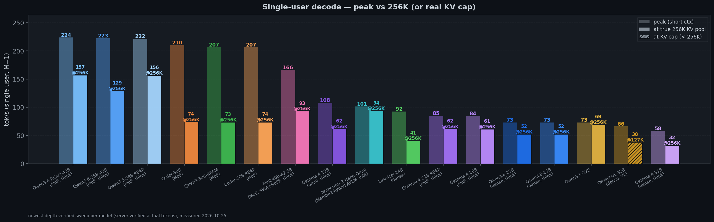
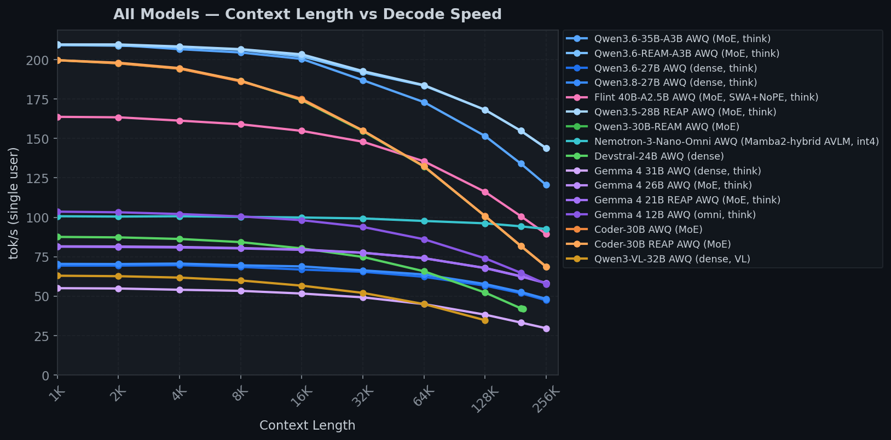
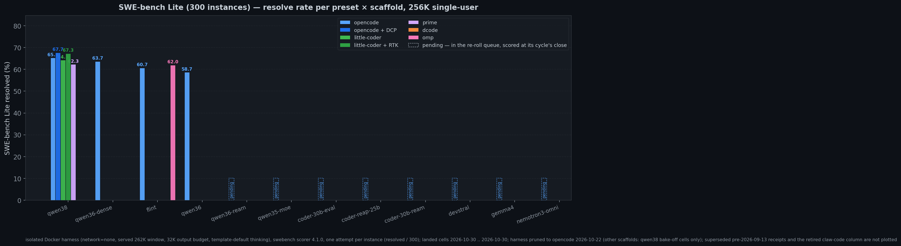
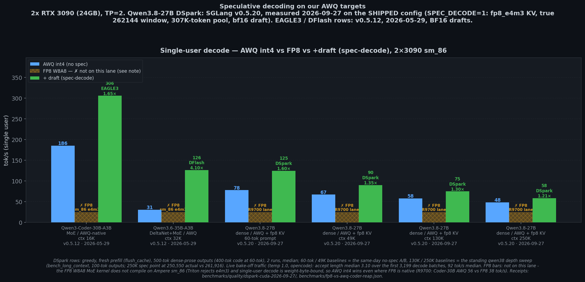

# NVIDIA Inference: SGLang on 2x RTX 3090

Single-user, **256K-context** LLM inference on 2× NVIDIA RTX 3090 (GA102, Ampere, 48 GB total) — SGLang **v0.5.22** + 29 local patches, CUDA 13.2 / PyTorch cu130, every model an **AWQ-int4 ship calibrated in-house** from the upstream BF16 base. This rig owns **all evals + AWQ/INT4 calibrations**; FP8 work lives with the [R9700 RDNA4 stack](https://github.com/mattbucci/2x-R9700-RDNA4-GFX1201-sglang-inference).

Long-form material lives in [`docs/`](docs/) — [decode levers](docs/decode-levers.md) · [SWE-bench harness](docs/swebench-bakeoff.md) · [quality-eval methodology](docs/quality-evals.md) · [roadmap detail](docs/roadmap.md) · [host setup](docs/host-setup.md) · [OCI image](docs/oci-image.md) — and the per-patch history in [`patches/README.md`](patches/README.md). Agent operating rules: [`CLAUDE.md`](CLAUDE.md), [`rules-for-agents.md`](rules-for-agents.md).

## Direction

**We optimize for 256K-context single-user agentic workloads on AWQ-int4 ships.** SWE-bench Lite is the canonical eval — every preset serves at full 256K (or model-card max) so agentic harnesses with multi-turn tool-call context (median ~41K, p90 ~82K, max 230K per instance) actually fit. Decode tok/s / TPOT at depth is the primary metric; multi-user throughput is secondary and never bought with single-user latency.

This rules out three axes other 3090 stacks chase:

| Their focus | Why not ours |
|---|---|
| Short-ctx multi-stream throughput (vLLM-style 80-140 TPS @ <32K) | We need the full prompt of an agentic instance in context; truncating mid-conversation loses correctness. |
| FP8 quantization | **FP8 W8A8 MoE doesn't compile on sm_86** (the Triton fused-MoE kernel needs `fp8e4nv`; Ampere Triton only has e5m2), and even where FP8 is native (R9700 gfx1201), AWQ-int4 wins single-user M=1 decode — weight-byte-bound, FP8 is 2× int4 (Coder-30B 56 vs 38 tok/s). FP8 is the R9700 lane. Receipt: [`benchmarks/fp8-vs-awq-coder-reap.json`](benchmarks/fp8-vs-awq-coder-reap.json). |
| Spec-decode (EAGLE3 / DFlash / MTP) | Draft acceptance collapses at depth and 256K + draft + cuda graphs OOM on 24 GB cards; 97% of SWE-bench prompts exceed the drafts' caps. Short-prompt opt-in only — [`docs/decode-levers.md`](docs/decode-levers.md#speculative-decoding). |

What we **don't** ship: random community quants. Every `mattbucci/*-AWQ` is calibrated end-to-end from the upstream BF16 base via our own GPTQ → CT → AWQ-Marlin pipeline, with thinking + image + video + audio preserved and probed. When a model needs MoE expert compression we run REAP (pruning) or REAM (merging) ourselves on the upstream weights (`scripts/quantize/run_reap.py`, `run_ream_qwen3moe.sh`).

## Results at a glance









Every deep point is **server-verified at its labeled depth** (`actual_input_tokens`; deepest honest point 255K = 262144 − output − margin), single-user (M=1), fresh prefill, at each model's real KV pool. **True-256K decoders:** the A3B DeltaNet MoEs lead (`qwen35-moe` / `qwen36-ream` **144 @255K**, `qwen36` 121, ~210 short), the Mamba2-hybrid `nemotron3-omni` is near-flat (101 → 93), the 30B-A3B coder trio sits at ~69 @255K (200 short), and the dense DeltaNet 27Bs (`qwen36-dense` / `qwen38`) at ~48 (70 short). The triton-backend presets (Flint, Gemma 4) were under-filling the GPU at depth until 2026-10-22 — the triton decode kernel's split-KV cap defaults to 8, which at M=1 / TP=2 puts 16–64 CTAs on 82 SMs; `--triton-attention-num-kv-splits 64` now ships on all five and moved `flint` 36 → **90 @262K**, the Gemma 4 MoEs and the 12B omni 24 / 17.5 → **58**, and the dense `gemma4-31b` 12.9 → **30** (exact attention; it beats the opt-in decode-topk lever's 26.2) — [flint bracket](benchmarks/flint/kv-splits-bracket-2026-10-22.md), [Gemma bracket](benchmarks/gemma4-kv-splits-2026-10-22.md). Expert pruning/merging does **not** speed M=1 decode (activated experts + attention dominate) — REAP/REAM win on KV headroom and footprint instead. **Quality:** the first isolated SWE-bench Lite cell is in — `qwen38` **196/300 (65.3 %)** on opencode, from a five-scaffold harness bake-off that is a statistical tie across the opencode / pi families (203 / 202 / 196 / 193; prime 187) and settled the eval harness on **plain opencode** ([receipt](benchmarks/quality/qwen38-v4-cycle-close-2026-10-22.md)); every historical cell (including the former `qwen36-dense` 62.3 % lead) ran with network open and under since-fixed scaffold context / output-budget defects — on the same 300 ids the exposed netopen cell scored 250 — so those reads are withdrawn and the remaining presets re-roll on the one lane; the Qwen3.6 family and the Gemma 4 26B/31B reason and tool-call perfectly at true 256K, while the Coder-30B family hits a ~64K agentic ceiling. Receipts and the full ledger: [`docs/decode-levers.md`](docs/decode-levers.md), [Quality evals](#quality-evals). **Speculative decoding (new, 2026-09-27):** DSpark spec-decode on `qwen38` is a validated **1.4–1.5× single-user decode win on our CUDA verify** (60-tok 1.54×, 34K 1.47×, 49K 1.39×; up to 2.79× on predictable output; **1.21× at 250K actual — 58.5 vs 48.4 tok/s — with the true 256K window kept because fp8 KV leaves a 307K-token pool under the draft**) — R9700's 0.24×-at-49K Triton cliff does **not** reproduce on flashinfer verify ([receipt](benchmarks/quality/dspark-cuda-depth-ab-2026-09-27.md), [fp8-KV/250K receipts](benchmarks/quality/dspark-cuda-2026-09-27/)). It serves the bake-off's `qwen38` cycle from 2026-09-27 (`SPEC_DECODE=1`). Drafts exist for `qwen38` (DSpark), `qwen36`-family (DFlash), `coder-30b-eval` + `devstral` (EAGLE3); NGRAM (no draft) covers the rest. **The spec-decode chart above is current (shipped config, 2026-09-27); in the decode/context PNGs the Flint and Gemma 4 curves are current (2026-10-22, kv-splits 64) while the other presets predate the current stack — re-measuring the fleet with spec-decode + current settings is a GPU campaign queued for the next serving-only window (it cannot run while a bake-off lane holds the GPUs).**

## Status & next steps

**RESTARTED 2026-09-20 — the 256K re-roll runs from scratch as isolated `-v3` cells, served from the OCI image (v0.5.20 until the 2026-10-19 boundary, v0.5.22 — 29 patches, campaign ledger [`patches/v0.5.22-rebase-status.md`](patches/v0.5.22-rebase-status.md) — from the 2026-10-20 resume on; each row's `meta.json` carries the served config and the scaffold pin, so a cell that straddles the boundary reads per row).** Every cell before it is exposure-confounded: the rollout container ran `--network=host`, and on the two finished qwen38 opencode lanes **56 % / 53 % of instances fetched upstream** (27 % their own PR; the exposed group's patches overlap the gold patch at a median 100 % of added lines and resolve at 94.6 % / 91.2 % vs 69.5 % / 76.4 % for the rest — an effect size, not a cell; [receipt](benchmarks/quality/swebench-leak-audit-qwen38-netopen-2026-09-19.md)). Every v3 cell carries: **no network** (an in-container loopback bridge is the only address), refs stripped past HEAD, per-instance mounts staged under a neutral path, `/testbed` re-initialised to one `eval@local` commit, the task on **stdin** from a read-only file, the served **262144** window / template-max thinking / **32768** output budget, and the pinned server image id — gated per lane by [`audit_leakage.py`](evals/swebench/audit_leakage.py) `--require-isolation` (0 exposed + all four isolation proofs on 300/300) and per cycle by the Phase-0 request audit. Contract, proofs, docker-serving parity smoke (qwen38 / qwen36: bench within −1.6 … +3.5 % of bare metal, 2-instance isolated rollouts clean) and the four harness defects the boundary smoke caught before any v3 cell rolled: [`swebench-harness-isolation-2026-09-20.md`](benchmarks/quality/swebench-harness-isolation-2026-09-20.md). Earlier harness-defect receipts that still hold: context budget (2026-09-11, `9c31fff`), thinking + output budget (2026-09-13), opencode subagent permissions (2026-10-21 — every opencode-family run writes a global `permission` block, `external_directory` / `doom_loop` / `read *.env` → allow, because opencode 1.14.25 `run` answers only the main session's asks and a `task` subagent touching a path outside `/testbed` idled to the wall; gated GPU-free by [`probe_opencode_subagent_permission.py`](evals/swebench/probe_opencode_subagent_permission.py) — control hangs at `action=ask`, fix completes in 3 s, [receipt](benchmarks/quality/opencode-subagent-permission-2026-10-21.md); cells rolled before it keep the class — [`audit_wall_causes.py`](evals/swebench/audit_wall_causes.py) reads it off the session snapshot as an open leaf tool part that outlived its own execution ceiling: 2 of the qwen38 v4 opencode cell's 33 first-pass walls (`django-16820`, `matplotlib-23562`; the other 31: 15 mid-think, 14 inside a running test suite's budget, 1 step boundary, 1 self-removed testbed env); both re-drew under the capture-at-wall re-roll and the closed cell's 13 walls class 9 tool-running / 3 mid-think / 1 step boundary, none a permission hang).

**Speculative decoding for the eval queue — DECIDED 2026-09-27: the campaign restarts as `-v4` with `qwen38` served under DSpark at the same true-256K window.** The 256K-vs-spec trade-off was a measurement artifact: with the preset's fp8_e4m3 KV the DSpark server's pool is **307,659 tokens at `--context-length 262144`** (draft weights cost 2.38 GB/card; a bf16-KV DSpark server only reaches 153K, which is where the "128K compromise" reading came from). Verified at 250,550 actual tokens: **58.5 tok/s vs 48.4 no-spec**, 119–130 at 60 tok, 69–80 at 130K, thinking + reasoning parser intact ([receipts](benchmarks/quality/dspark-cuda-2026-09-27/)). Spec is rejection-sampled, so resolved-rate stays unbiased at the bake-off's temp=1.0; the point of the flip is the **wall rate** — 17.7 % of the no-spec qwen38 opencode cell walled (53/300 rc 124, ≈29 h of its 96 h; 12 more finished past 1795 s of `rollout_seconds` because that figure spans the image build), and R9700 reports its first spec instances finishing in 210–658 s against a 1245 s no-spec mean. Mechanics: `SPEC_DECODE=1` opt-in on the `qwen38` preset (patch 099 + the flattened draft at `drafts/qwen38-dspark`), `SPEC_FOR=qwen38:1` in `run_all_cycles.sh` (the other presets stay no-spec until their opt-ins are validated at 256K/fp8 KV), `RUN_TAG=v4`, every cell's `meta.json` records the served config from `/get_server_info`. The finished v3 qwen38 cells (opencode 300/300, opencode-dcp 201/300) are kept as the **no-spec reference**. **Sample read (2026-09-27, 31 instance-matched opencode pairs, [receipt](benchmarks/quality/dspark-cuda-2026-09-27/v4-vs-v3-paired-sample.md)): spec walls 2 vs 3, empties 3 vs 3, median rollout 739 s vs 992 s (−25 %), mean 854 vs 1015 s, per-instance median speedup 1.16×; 0 errors.** The gain is entirely in the model-bound session phase (735 → 525 s median; image build + boot unchanged at ~200 s), the live lane shows accept length 3.0 / 88.7 tok/s median over 12K decode batches, and the one done→wall flip (`django-11742`) was a session mid-final-summary at 1800 s — a capture-at-wall case, not a spec effect. Spec therefore stays on for the whole v4 cycle; the full-300 cell is the number that lands in the bake-off table. **Full first pass (2026-09-30, 300/300, 292 instance-matched pairs — 8 v4 rows whose rollout image failed to build re-roll at Phase 4; [receipt](benchmarks/quality/dspark-cuda-2026-09-27/v4-vs-v3-paired-first-pass-300.md)): walls 33 vs 52 (11.3 % vs 17.8 %), empties 33 vs 53, median rollout 801 vs 1108 s (−28 %), mean 960 vs 1147 s, per-instance 1.18×, flips wall→done 36 / done→wall 17; session phase 537 vs 735 s with build + boot unchanged (193 vs 198 s); accept length 3.02 / 88 tok/s median over 124K decode batches, steady from first hour to last; 0 server errors; leak gate 0 exposed on 153 attempts.** Non-wall empties are the model's final think hitting the 32,768 output budget (`finish_reason=length`: 2 in v4, 1 in v3). Spec stays on for the remaining five v4 lanes; resolved-rate is compared only after scoring.

**Next steps, in order:**

1. **SWE-bench queue — harness pruned to opencode (2026-10-22).** The `qwen38` v4 cycle closed as the five-scaffold harness bake-off: opencode **196** / opencode+DCP **203** / little-coder **193** / little-coder+RTK **202** / prime **187** resolved on the same 300 isolated instances. Every pair except prime-vs-the-two-plugin-lanes is a McNemar tie (opencode vs little-coder p = 0.74; DCP p = 0.36 and RTK p = 0.18 against their controls — both plugin A/Bs null), so the pick is on moving parts, wall rate (13 vs little-coder's 25), longitudinal comparability (opencode has a cell on every historical preset and is R9700's paired reference) and the Flint tooling target: **plain opencode** — table, pairwise matrix, reasoning, recall audit and the per-lane chronology in the [cycle-close receipt](benchmarks/quality/qwen38-v4-cycle-close-2026-10-22.md); `opencode-dcp` is one token in `SCAFFOLDS_FOR` if the literal top cell is preferred. The queue holds on PAUSE before `qwen36-dense` and resumes on the one lane ([`systemd/swebench-bakeoff.override.conf`](systemd/swebench-bakeoff.override.conf): `QUEUE` without `qwen38`, every preset `:opencode`) after the boundary work — the gpu-unlock cold boot + measurement (item 3.2), the Flint bring-up (item 2), the loopback bridge launched from a staged script so its port is not in `ps` argv plus a model self-dispatch policy. Dropped with the pruning: the `-v5` dcode / omp / prime-0.10.0 one-off cycle and the `-respsplit` dcode scoring (both lanes' defects are receipted; neither rolls again). Then the historical re-roll in queue order, `nemotron3-omni` last.
2. **Flint ([RecursiveSI/flint](https://huggingface.co/RecursiveSI/flint), 40B-A2.5B agentic-coding MoE — user request 2026-10-22) — SHIPPED as `launch.sh flint` + [`mattbucci/Flint-AWQ`](https://huggingface.co/mattbucci/Flint-AWQ); the full-300 cell is HELD — the 2-instance parity smoke on the rebuilt serving image (`a97be8febd89`) produced 0/2 patches, both sessions lost to 32,768-token degenerate-repetition turns (see the end of this item).** Architecture: 256 sigmoid-routed experts top-6 + an ungated shared expert, 35 sliding-window (513) + 14 full-attention **NoPE** layers, learned per-head attention sinks, QK-norm — stock Qwen3-MoE blocks otherwise; the vendor's `flint_sglang` plugin is ported to v0.5.22 under `plugins/flint_sglang/` (installed by `setup.sh`; port delta in its README). **Checkpoint:** BF16 is 79.6 GB and the vendor's MLX INT4 export cannot be re-encoded as AWQ (free per-group bias), so `scripts/quantize/quantize_flint_rtn_awq.py` re-quantizes the BF16 base data-free — per-group MSE-clipped RTN on the integer-zero grid, g64 asymmetric (0.0875 relative RMS on expert tensors vs the vendor's 0.086), router / embeddings / `lm_head` / sinks / norms BF16 → 20.9 GiB in 200 s on one GPU; `check_awq_scales.py --base` clean (0 / 36,439, [log](benchmarks/quality/flint/check_awq_scales-Flint-AWQ-INT4-g64-2026-10-22.log)). A conversion, not a calibration (transformers has no Flint modeling file, so no llmcompressor path — the calibrator at the end of this item is the replacement); an attention-in-BF16 variant did not move the needle cells ([receipt](benchmarks/quality/flint/needle-haystack-discriminator-2026-10-22.md)). **Serving (TP=2 / 262144):** triton attention (the only Ampere backend with sinks + `SWAKVPool`), AWQ-Marlin fused MoE (runner must stay `auto`), bf16 KV (triton rejects E4M3 on sm_86; the pool is 588,614 full / 29,430 SWA tokens at ratio 0.05), the `flint` parser trio, `--enable-fp32-lm-head`, sampling from `generation_config` (T 1.0 / top-p 0.95 / top-k 20); **TP=2 validated against TP=1** ([receipt](benchmarks/quality/flint/tp-check-2026-10-22.md); a boot needs `swa_layer_tokens ≥ chunked_prefill_size + 513` or prefill deadlocks). **Decode: `--triton-attention-num-kv-splits 64` (CUDA default 8) — 35.9 → 89.5 tok/s @261,916 actual, 114.8 → 147.5 @32K, 59 → 116 @131K, 1K within 1 %** ([bracket 8/32/64/128](benchmarks/flint/kv-splits-bracket-2026-10-22.md)): at M=1 / TP=2 Flint has 2 KV heads per rank, so the default put 16 CTAs on 82 SMs and the 14 full-attention layers walked 262K tokens in 8 serial chunks; the same flag now ships on all four Gemma 4 presets (also triton; 13–24 → 30–58 tok/s at depth, [bracket](benchmarks/gemma4-kv-splits-2026-10-22.md)). Prefill stays ~1–2.4 K tok/s on triton (a 250K fill ≈ 4 min) — the open lever. **Tool calls: `FLINT_STRICT_TOOLS=1` (preset default) — the plugin's grammar enforces every tool's argument schema.** Flint ignores JSON-schema `required` keys on its own: opencode's `bash` needs `description`, `read` takes `filePath`; the checkpoint wrote `path` and no description in 23/24 calls with the grammar off *and* with it on schema-free, 20/20 with the schema enforced ([receipt](benchmarks/quality/flint/tool-schema-probe-2026-10-22.json)); the first parity-smoke rollout lost 86 turns to SchemaError retries. The vendor's SWE-bench path is mini-swe-agent (bash in text), which never exercises this contract. **Needle: probe Flint with a natural-text haystack.** The stock repeated-sentence filler is a repetition attractor on the 14 NoPE layers (6/6 at 1K/32K, @0.1 only at 131K, 0/3 at 250K — reproduces greedy and after `/flush_cache`, kernels reviewed clean); an Open-Platypus haystack retrieves at **131K and 243.5K actual, both depths, greedy**, and 2/3 at 243.5K under the model's own sampling. `needle_band_probe.py --haystack` / `--chars-per-token` / `--flush` + [`build_natural_haystack.py`](scripts/eval/build_natural_haystack.py) ship for it; Flint quality receipts use the natural haystack, the filler cells are a known-bad input. **Runaway repetition in agentic turns (open, 2026-10-22).** Docker parity on the rebuilt image is exact (boot / auth / Responses API pass; decode 163.9 / 147.3 / 89.4 tok/s vs the bare-metal baseline), but the opencode rollout half produced 0/2 patches: 4 of the 51 assistant turns across the two sessions ran to the 32,768-token output cap in a degenerate loop — two inside `bash` tool-call arguments (a Python one-liner derails after ~400–1,000 characters into `type and type and type is type …` / `in { top in if 0 else ""} out { …`), one 10.8K characters into the reasoning (`2 in 2 out, 2 out, 2 in 2 out …`), one more in reasoning that opencode did not store; contexts 15K / 68K / 109K / 105K tokens, sampling = the vendor's T 1.0 / top-p 0.95 / top-k 20. A tool-argument runaway comes back as the next request's `invalid` tool call (+33K tokens of the loop in context), so one event poisons the rest of the session; a reasoning runaway has no tool call, so opencode ends the turn — empty diff either way. Same attractor as the needle-filler failure, now on natural agentic input; grammar-free (the reasoning case) so not the strict-tools grammar per se. **Root cause (2026-10-22): the data-free INT4 of the always-active path, not the stack.** The four turns replayed byte-faithfully (same prompt-token counts; `scripts/eval/replay_turns.py`): the poisoned 68K prefix loops **11/24** on the ship config at the vendor's sampling and *more* at lower temperature (T 0.6 24/24, greedy 2/2 — the loop is the argmax path of the damaged model on that prefix; T 1.0 sampling escapes it half the time; the clean 15K / 105K / 109K prefixes are 0/2 greedy) and every serving arm is null (kv-splits 8 15/24, grammar off 14/24, hybrid SWA pool off 13/24; penalties on the 15K prefix 0–1/48). Re-quantizing with attention + shared expert in BF16 (routed experts still INT4) gives **0/24 and 0/48**; attention-only BF16 still 9/24. A serving-independent fp32 reference forward ([`flint_cpu_reference.py`](scripts/eval/flint_cpu_reference.py), validated against the live server) puts numbers on it over the first 2,048 prompt tokens vs the BF16 base: the ship checkpoint agrees on top-1 only **64 %** (mean KL 0.73 nats, next-token ppl 32 → 47; the serving stack itself adds KL 0.11 on top of the checkpoint); INT4 attention alone costs KL 0.37, the 0.3B-parameter shared expert alone 0.43, all 256 routed experts together 0.26, attention+shared BF16 0.28, g32 0.49 (and g32 serves as garbage through AWQ-Marlin MoE — open bug, checkpoint itself is sane). Per-tensor weight error is a uniform 8.8 % RMS, so the loss is in how the rounding error projects onto the activations, not in any one tensor — and a per-channel AWQ scale search alone recovers only 3–14 % of a layer's loss, while GPTQ error feedback on the same activation Grams cuts the 3-layer hidden-state error 3.6× in-sample / 27 % held-out on a 5.6K-token smoke. **Now:** a calibrated re-quantization — [`quantize_flint_awq_calib.py`](scripts/quantize/quantize_flint_awq_calib.py), a reference-forward calibrator (no transformers modeling file needed): AWQ scale search folded into the norms / router / `up_proj` rows + GPTQ (act-order, static groups → plain AWQ layout) on Grams from 139K in-domain tokens (code reasoning, raw code, a held-out agentic session, SWE-bench statements, instructions), ~15 GPU-minutes per build. Three builds (all-INT4; routed experts only with the always-active path BF16; shared expert BF16) are scored by the same KL table and the replay rate; the decision is the all-INT4 build if it approaches the 0.28 of the BF16-path variant and replays clean, else the experts-only build (+1.6 GiB; its decode cost is measured before shipping). R9700's FP8 replay of the same prefixes is the external reference. The cell stays held until a checkpoint replays clean; the queue resumes with the historical presets meanwhile. Open levers after that: `fp8_e5m2` KV, `--mem-fraction-static` (the full pool is 2.2× the window), prefill speed on triton.
3. **GPU-profile experiments** — from the live-traffic profile of this cycle ([`benchmarks/qwen38-agentic-workload-profile-2026-09-10.md`](benchmarks/qwen38-agentic-workload-profile-2026-09-10.md)): server time is 86% decode, and a decode step is 57% INT4 weight streaming (78% of DRAM peak), 12% NCCL latency, 10% fp16 `lm_head`, 7% attention — 55% of the bandwidth roofline. Ranked by exposed time, each gated on needle + HumanEval + the tool probe:
   1. **DSpark speculative decoding on qwen38 — SHIPPED as the `SPEC_DECODE=1` opt-in (1.4–1.5× decode at short/mid depth, 1.21× at 250K, true 256K kept via fp8 KV).** CUDA A/B receipt: [`dspark-cuda-depth-ab-2026-09-27.md`](benchmarks/quality/dspark-cuda-depth-ab-2026-09-27.md) (60-tok 1.54×, 34K 1.47×, 49K 1.39×, 2.79× on predictable continuations — R9700's 0.24×-at-49K Triton cliff does not reproduce on flashinfer verify); fp8-KV / 250K receipts in [`dspark-cuda-2026-09-27/`](benchmarks/quality/dspark-cuda-2026-09-27/). In tree: patch 099 (`pp_proxy_tensors=` kwarg port, 3-gate clean), [`flatten_dspark_speculators_config.py`](scripts/specforge/flatten_dspark_speculators_config.py), the v4 harness wiring. **Remaining (boundary, GPU-bound):** `bench_regression.sh` baseline for the spec arm at the true KV cap + needle/HumanEval/tool-probe gate on the served config; ship the flattened draft to `mattbucci/Qwen3.8-27B-DSpark-sgl`; validate the other opt-ins at 256K/fp8 KV before adding them to `SPEC_FOR` — the `qwen36` DFlash opt-in still carries v0.5.1x flags (`SGLANG_ENABLE_SPEC_V2`, `--mamba-scheduler-strategy`) and a 32K window, EAGLE3 (`coder-30b-eval`, `devstral`) is validated at 16K only, NGRAM (patch 064, no draft) covers the REAP/REAM variants.
   2. **GA102 tensor-rate unlock ([Zagitta/gpu-unlock](https://github.com/Zagitta/gpu-unlock)) — staged 2026-10-22, measured at the next cold boot.** GeForce GA102 runs FP16/BF16 tensor math with fp32 accumulate at half the rate of the pro silicon; the module runs FWSEC-FRTS + Booter (CMP V67 signature) from the initramfs before `nvidia` binds, opens the speed selectors (SS0 `0x88888888`, SS1 `0x8`) and flashes nothing — a power cycle restores stock. Expected profile here: Marlin INT4×fp16 GEMM and flashinfer prefill are compute-bound at 256K, so TTFT / prefill (up to ~1.6–2×) and multi-user throughput move; batch-1 decode is weight-streaming-bound and should not. Stock receipt at the 260 W cap: **60.4 / 58.5 TFLOPS fp16-fp32acc, 60.9 / 59.4 bf16, 41.4 / 41.6 TOPS int8, 889 GB/s read** per card ([`baseline-stock-260w.json`](benchmarks/gpu-unlock-2026-10-22/baseline-stock-260w.json), [`tensor_rate.py`](scripts/bench/tensor_rate.py)). Installed: dkms module + the pinned 610.43.03 firmware in every initrd as `rd.driver.pre=gpu_unlock` ahead of `nvidia`, plus a `systemd-modules-load` ordering drop-in (the stock initrd pulled `nvidia-uvm` at 1.86 s, before dracut-pre-udev finished — a race the author's mkinitcpio path does not have); inert until `gpu_unlock.targets=all` is on the kernel command line, and the card must be cold (a warm reboot is refused). The power-off goes in the qwen38→qwen36-dense boundary. Gates (the stack-flip campaign, tagged `unlock` against the stock `v0522` receipts): `tensor_rate.py` ≈2× on fp16/bf16 with the bandwidth control flat, `bench_regression.sh` on all 8 tripwire presets (TTFT + decode vs the 2026-10-20 baselines), `flip_fleet_validate.sh` quality + capability probes on `qwen38` / `qwen36` / `gemma4` / `devstral` (T=0 suites — a tensor-rate change must not move a single score), `compare_flip_receipts.py`; any regression → drop the option, power-cycle back.
   3. **`lm_head` INT8 (or INT4) through Marlin** — the only fp16 weight left in the step (1.27 GB/rank, already at roofline); load-time W8 patch or calibration-recipe change. −4.6% / −7% per step.
   4. **PCIe host-read decisive tests** — 3–4 GB/s of GPU-initiated host reads during decode for no known purpose: 60 s each under `dmon` with `--disable-cuda-graph` and `NCCL_P2P_LEVEL` / `NCCL_WORK_FIFO_DEPTH` variants.
   5. Smaller levers: `in_proj_ba` fp16 gemv → real kernel (−2%), P0 memory clock via `-lmc` (~+1.5%), W4A8 Marlin for prefill (≤−4% e2e, activation-quant quality gate), prefill-only NCCL `Simple` protocol via a tuner plugin (−0.5% e2e). Custom allreduce (−6%) stays blocked on sm_86 graph capture (re-test `ENABLE_CUSTOM_AR=1` at each rebase). 350 W power cap = +5.5% only — rejected, the DIMMs are at ALARM HIGH.
4. **Wall-hit convention — capture-at-wall, adopted 2026-10-08 mid-qwen38-cycle as a harness-defect fix (user call: a convention that discards a finished fix is a defect, not a rule to hold until the next boundary).** Until now opencode / little-coder / prime were killed at 1800 s and a wall hit was an empty diff *by construction* (the in-script `=== DIFF ===` + `git diff --cached` sits after the scaffold and its 120 s cleanup pass), so complete, model-verified fixes were lost (`django-14999`, `sympy-17022`, `django-15252`, the rtk lane's `requests-863` / `xarray-3364` edits) and a `ps`-echoed marker could surface a JSON tail as a 20–200 KB non-patch. [`docker_rollout.py`](evals/swebench/docker_rollout.py) now reads `/testbed` from the still-running container at the wall (`capture_diff_live`: private index seeded from HEAD, `add -A` minus the scaffold scratch dirs, `diff --cached`, byte-faithful) before the kill — the same rule R9700's sandbox has run all cycle (41/73 of their opencode-v5 walls carried a patch), so the two matrices now share one wall rule. Rows carry `model_timeout: true` + `patch_source` (`wall-exec` / `stdout` / `stdout-fallback` / `wall-exec-failed`), so resolved-at-wall stays separable; the stdout tail is never used on rc 124. **Same change, sibling defect closed:** the prelude writes the image's own untracked baseline (`psf__requests-863`'s `build/`) to `.git/info/exclude` at re-init and reports `excluded=K`; the isolation gate accepts `dirty + excluded == dirty_before` — that instance was unresolved-by-construction in 26/32 historical cells (874 KB of `build/` hunks apply-failed every method). Verified on the live `requests-863` image (`dirty=0 dirty_before=1 excluded=1`; capture works through a model-held `index.lock`; [unit test](evals/swebench/test_audit_predictions_wall_capture.py)). **How it reaches the in-flight cycle:** the rolling rtk lane keeps its already-loaded harness (prime and dcode start fresh processes and get the fix directly); `audit_predictions.py` classes every rc-124 row rolled before the capture — or whose capture failed — as `infra_wall_capture_defect`, so Phase 4 re-rolls them under the fixed harness like any other harness failure: **82 pre-capture walls on the three live lanes so far (opencode 33, DCP 35, rtk 14 of 176; the pi-0.68 little-coder cell's 16 left with it when it was quarantined — item 1) plus the known infra rows, ≈35–50 GPU-hours added to the cycle** (the re-roll pass runs at the lane's `--max-empty-streak 30`). Each lane's `predictions.jsonl.pre-reroll` keeps the first-draw rows, so the paired wall-rate reads (spec vs no-spec, DCP / RTK A/B) use first-draw walls while resolved-rate uses the re-rolled rows; a second draw of a walled instance is an unbiased sample of it, so resolved-rate expectation matches a one-draw capture-at-wall cell. The v3 no-spec reference cells stay pre-capture (their walls are empties; the spec-vs-no-spec resolved comparison therefore favours v3 by at most its 53 walls' at-wall patches — read it with the wall counts beside it). **Still at the boundary, serving side — the serving image rebuild with patches 065 + 066** (both 3-gate clean and in the live tree; then `smoke_docker_serving.sh` parity, a live `probe_responses_api.py`, and `bench_regression.sh` compare on the Qwen3-Coder-parser presets; the re-pinned pi-0.83 control no longer pays 065's defect, but any index-blind client would; 066 is what the dcode re-roll waits on — item 1). Also at the boundary, harness side: merge the `omp` lane into the roster (item 1), launch the loopback bridge from a staged script so its port is not in `ps` argv, and decide whether model self-dispatch through it is allowed (item 1). And carry 063 + 065 + 066 upstream: sgl-project `main`'s detector still scores 2/8 on [`test_qwen3_coder_detector_orphan_tags.py`](scripts/eval/test_qwen3_coder_detector_orphan_tags.py) (R9700 reproduced it byte-for-byte on their tree), so index-blind clients hit it on every release.
5. **Harness lever — stop building per-instance rollout images.** Measured on the v3 lanes ([receipt](benchmarks/quality/gpu-utilization-harness-overhead-2026-09-26.md)): the GPUs are busy **73 % / 65 %** of the opencode / opencode+DCP lane's wall clock, the rest is one 5–10 min gap per instance, and the per-instance image build is **176 s** median (dcode conda env 68 s + layer export 60 s), 14–16 % of `rollout_seconds` — **≈ 289 h over the remaining ~5,900 instances**. R9700 runs exactly this design (hub image + bind-mounted toolchain) and measures **97.3 % / 97.8 % GPU-busy** on the same two lanes with a **5 s** scaffold boot (`f4407eb`) — a direct proof the ~32 % idle is all recoverable. The DCP lane's extra 70 s boot and its dead 120 s cleanup pass (cleanup session on 11/276 vs 276/276 control, qwen38 v4) were opencode 1.14.25 forking `npm install @opencode-ai/plugin` into the config dir at every start and waiting for it before loading plugins — 70 s per stale packument under `--network none`; closed by pre-installing the package in the rollout image and `npm_config_offline=true` on both opencode lanes (DCP boots in 2.3 s, plugin loaded; [receipt](benchmarks/quality/opencode-dcp-boot-tax-2026-10-21.md)). R9700 never paid it: their config dirs are mounted read-only and opencode skips the install. The per-instance build is also a **network dependency per instance**: every step (apt, nodejs.org, three npm installs, two `curl | sh` installers, conda) re-runs for each base image, and two independent registry blips cost the qwen38 opencode v4 lane **8 of its first 53 instances** — npm (2026-09-27 21:23–21:26, the DCP plugin step, 7 consecutive; the first build failures in 535 instances) and PyPI (2026-09-28 02:17, `quickjs-rs` momentarily had no distribution so `deepagents-code` hit `ResolutionImpossible`, 1) — and a third, the prime-agent installer at `app.primeintellect.ai` answering HTTP 500 for ~6 min (2026-10-04 17:09–17:15 PDT), failed **9 consecutive little-coder builds** (`django-11742`…`12113`) on a lane that never runs prime-agent — and the same installer plus npm E404s took 14 more on the rest of the little-coder lane — and on 2026-10-09 the same installer stopped being a blip: upstream pruned every pre-0.10.0 prime-agent release (0.10.0 is a Rust rewrite, a different program), so every per-instance build 404'd for an hour and **29 consecutive little-coder instances** (`django-13590`…`15202`) crashed before the tick caught it. The 0.8.1 footprint is now **vendored** into the build context (`evals/swebench/docker/prime-agent-0.8.1-vendor.tgz`, sha-pinned; fetch or recapture with [`vendor_prime_agent.sh`](evals/swebench/vendor_prime_agent.sh), mirror `mattbucci/swebench-scaffold-vendor`) and extracted by the Dockerfile instead of downloaded — the image environment is byte-equivalent, the pins unchanged, the lane resumed at the next instance without stopping the queue; the 0.10.0 re-pin is a cycle-boundary change gated on the Phase-0 request audit — and on whether 0.10.0 retries after a `length` stop (0.8.1 does not; it is what made 31 of the prime cell's 32 empties — a re-pin that adds a retry is a scaffold-behaviour change, recorded per cell like the pi re-pin, never a re-label). Then on 2026-10-12 the npm registry itself: `npm install -g opencode-ai@1.14.25 little-coder@1.1.0` failed with `ETARGET` on a transitive `@aws-sdk/credential-provider-node@^3.972.86` for five minutes (18:45–18:50 Z) and **20 consecutive little-coder-rtk instances** (`sympy-13471`…`16106`) crashed at ~15 s each — a build that fails fast turns a short blip into a long streak, so a bounded `docker build` retry (three attempts, ~10 min) before the crash row is the interim fix. Then 2026-10-13: a 25-minute host-network blip (`github.com:443 Connection refused` in the rtk-installer step, `ECONNRESET` from the npm registry) took 3 prime rows on a lane whose own scaffold is vendored and offline. 85 instances lost to upstream outages so far in this cycle, each classed `infra_rollout_nonzero_rc` and re-rolled at lane close, never a model number. A hub image built once removes both the 176 s and the exposure. Bind-mount a host-built scaffold stack (`/opt/node`, npm prefixes, the A/B HOMEs, dcode's env, `rtk`) read-only into the official `swebench/sweb.eval.x86_64.<iid>` image — same versions, same `testbed` env, zero builds. Candidate for the qwen38 → historical boundary of the re-roll queue (a harness-version change recorded per cell), otherwise after the queue.
6. **Patch 058 observational cell** — a fresh full-300 opencode `devstral` cell post-058 vs the completed pre-058 cell (clean A/B on the empty-diff rate; ship receipt [`devstral-058-baseline`](benchmarks/quality/devstral-058-baseline-2026-07-19.txt)).
7. **Tooling for the MoE backlog:** port the Samsung SAIL REAM merge to the Gemma 4 arch (40–60 h; plan [`scripts/quantize/ream_gemma4_port_plan.md`](scripts/quantize/ream_gemma4_port_plan.md)); extend `run_reap.py` to the Gemma 4 parallel dense+MoE and Nemotron-H Mamba2-hybrid layouts (the fused-`Qwen3_5Moe` unfuse is done, 7/7).
8. **Calibration backlog (calibration device, not this box):** `North-Mini-Code-1.0-AWQ` → `Qwen3.6-35B-A3B-REAP-AWQ` → `gemma-4-26B-A4B-REAM-AWQ` → the `Qwen3.6-VL-30B-A3B` native/REAM/REAP trio with vision retained → `Qwen3-30B-Instruct-2507` native + REAP → `Qwen3.5-28B-A3B` native + REAM → Nemotron REAP/REAM; plus a Marlin-friendly `gemma4` requant (the sole fix for the Gemma fallback-kernel decode). Gated further out: a `Qwen3.8-Flash-Next` REAP/REAM shrink (blocked until sglang ships the QSA model class), the `diffusiongemma-26B-A4B` port, the official Gemma QAT-W4A16 compare. Recipes and rationale: [`docs/roadmap.md`](docs/roadmap.md).
9. **User-gated:** green-light the six prepared upstream-PR packages (`scripts/upstream-pr/`, 011 first — its 7-site hand re-port recurs every rebase); schedule the sudo-domain durable fix for the ~9–17 h docker-I/O kernel BUG (every multi-day cycle eats a crash).

### Known issues (open)

- **`nemotron3-omni` decode −12% at depth since v0.5.18** (93.3 → 82.4 tok/s @261,916; v0.5.20 measures 85.9, v0.5.22 85.2 — flat hop to hop, −8.7 % against the same kept baseline, inside the band). Bisected to the flashinfer-side decode dispatch (0.6.15.post1 → 0.6.17); preset unchanged (still the fastest path), tripwire baseline deliberately kept at 93.3 so each flip measures against one reference; upstream-report candidate with receipts `benchmarks/regression/exp-nemotron-*.json`.
- **Host reboots every ~9–17 h under sustained docker rollout I/O (kernel BUG).** Predictions on disk survive; `swebench-bakeoff.service` auto-resumes. Durable fix is user-gated (item 9). Forensic recipe: [`CLAUDE.md`](CLAUDE.md) → Operational Lessons.
- **Qwen3.6 greedy-needle knife-edge (`qwen36` 131,072@0.5, `qwen36-vl-reap` 1,024@0.1 / 16,384@0.5) — a checkpoint repetition attractor, not the stack.** At T=0 the think starts quoting the haystack filler and never stops (`finish=length`, empty content); reproduced on the retained v0.5.20 env, the neighbouring cells answer 36/36 from a flushed cache, a 4,096 budget changes nothing, and under the checkpoint's own sampling the loop moves to a different cell. Watch item: if a fleet eval drops `qwen36` below 14/15, bisect the full-attention path with the flushed-band recipe in [`patches/v0.5.22-rebase-status.md`](patches/v0.5.22-rebase-status.md); `needle_band_probe.py --temperature default` separates a greedy knife-edge from a sampled miss.
- `check_awq_scales.py` reads native-AWQ format only — CT-format checkpoints crash its tensor reader (use a native-AWQ mirror or HF Range-fetch mode).

## Model Support

**Max ctx** = what the AWQ ship + 2× 24 GB actually serves end-to-end (validator + bake-off receipts). Every preset defaults to the full ctx; single-user tok/s measured at the listed context with **fresh prefill** (radix cache disabled).

| Model | Type | Max ctx | tok/s | Launch | HF + notes |
|-------|------|:-------:|:----:|:------:|:-------|
| **Qwen3.6-35B-A3B AWQ-Marlin** | DeltaNet+MoE A3B (256 exp, VL) | **262K** | 209 (**121 @255K**) | `qwen36` | [`mattbucci/Qwen3.6-35B-A3B-AWQ`](https://huggingface.co/mattbucci/Qwen3.6-35B-A3B-AWQ). |
| **Qwen3.6-REAM-A3B AWQ** | DeltaNet+MoE A3B (192 exp, VL) | **262K** | 209 (**144 @255K**) | `qwen36-ream` | [`mattbucci/Qwen3.6-REAM-A3B-AWQ`](https://huggingface.co/mattbucci/Qwen3.6-REAM-A3B-AWQ). Vision tower grafted. |
| **Qwen3-30B-Instruct-2507 REAM AWQ** | MoE A3B (96 exp) | **262K** | 200 (**69 @255K**) | `qwen3-ream` | [`mattbucci/Qwen3-30B-Instruct-2507-REAM-AWQ`](https://huggingface.co/mattbucci/Qwen3-30B-Instruct-2507-REAM-AWQ). REAM 128→96; text-only generalist. |
| **Qwen3.5-28B MoE REAP** | DeltaNet+MoE A3B (205 exp, VL) | **262K** | 210 (**144 @255K**) | `qwen35-moe` | Cerebras REAP of Qwen3.5-28B-A3B; thinking+vision. |
| **Nemotron-3-Nano-Omni-30B-A3B AWQ** | Mamba2-hybrid MoE A3B (128 exp, AVLM) | **262K** ✓ (5.25M pool) | 101 (**93 @255K**) | `nemotron3-omni` | [`mattbucci/Nemotron-3-Nano-Omni-30B-A3B-Reasoning-AWQ`](https://huggingface.co/mattbucci/Nemotron-3-Nano-Omni-30B-A3B-Reasoning-AWQ). int4; **6/6 caps** (basic+thinking+tool+vision+**video**+**audio** — the only audio ship). Serves via **`QUANT=moe_wna16`** (baked into the preset; the auto-detected awq_marlin path fails on this model's TP=2 shard shapes — mechanism in `patches/v0.5.14-rebase-status.md`), enabled by **patches 052** (non-gated squared-ReLU moe_wna16) + **053** (EVS video routing). Mamba2 O(1) recurrent → decode ~flat (101→93 @255K); beats R9700 FP8 (74.79/49.22). ⚠ **Agentic depth 131K (needs ≥8K token budget; 76K at 2K)**: ≥196K it spirals past even 8K and at 253K stops calling entirely — flat decode does not buy agentic 256K here. |
| **Qwen3-Coder-30B-A3B AWQ** | MoE A3B (128 exp) | **262K** | 200 (**69 @255K**) | `coder-30b` or `coder-30b-eval` | [`mattbucci/Qwen3-Coder-30B-A3B-AWQ`](https://huggingface.co/mattbucci/Qwen3-Coder-30B-A3B-AWQ). Two presets serve the same model; for short-ctx batch-decode benchmarks override `CTX=16384 MAX_RUNNING=32 ./scripts/launch.sh coder-30b`. |
| Coder-REAP-30B AWQ-Marlin | MoE A3B (96 exp) | **262K** | 200 (**69 @255K**) | `coder-reap-25b` | [`mattbucci/Qwen3-Coder-30B-A3B-REAP-AWQ`](https://huggingface.co/mattbucci/Qwen3-Coder-30B-A3B-REAP-AWQ) (R9700 in-house). |
| **Gemma 4 31B Dense AWQ** | Dense (VL) | **262K** ✓ (347K pool) | 55 (49 @32K, **30 @255K**; was 13 before `--triton-attention-num-kv-splits 64`) | `gemma4-31b` | [`mattbucci/gemma-4-31B-AWQ`](https://huggingface.co/mattbucci/gemma-4-31B-AWQ). LM INT4, vision tower FP16, **KV fp8_e5m2**. Tool-use 1.0 → 258K true tokens, 5/5 caps incl. video. 347K pool via `--swa-full-tokens-ratio 0.05` + `MEM 0.92` + e5m2 FP8 KV (the only FP8 that compiles on the triton-forced path — sm_86 rejects e4m3). |
| **Gemma 4 26B MoE AWQ** | MoE A4B (103 exp, VL) | **262K** ✓ | 82 (78 @32K, **58 @255K**; was 24 before kv-splits 64) | `gemma4` | [`mattbucci/gemma-4-26B-AWQ`](https://huggingface.co/mattbucci/gemma-4-26B-AWQ). **Tool-use 1.0 → 258K true tokens, 5/5 caps** incl. video. 652K-token full pool via `--swa-full-tokens-ratio 0.0625`. |
| **Gemma 4 12B Unified AWQ** | Omni, encoder-free | **262K** ✓ | 104 (94 @32K, **58 @255K**; was 17.5 before kv-splits 64) | `gemma4-12b` | [`mattbucci/gemma-4-12B-AWQ`](https://huggingface.co/mattbucci/gemma-4-12B-AWQ). In-house int4 RTN-from-QAT. MMLU 77 / HE 93 / **tool-use 1.0 → 258K true tokens**, **5/5 omni** (vision + video ✓; gemma4_unified is native since transformers 5.12.1). 565K-token full pool via `--swa-full-tokens-ratio 0.0625`. |
| **Qwen3.6-27B Dense AWQ** | Dense + DeltaNet (VL) | **262K** (657K KV) | 69 (**47 @255K**) | `qwen36-dense` | [`mattbucci/Qwen3.6-27B-AWQ`](https://huggingface.co/mattbucci/Qwen3.6-27B-AWQ) (R9700 self-cal). |
| **Qwen3.8-27B AWQ** | Dense + DeltaNet (VL **+video**) | **262K** (652K KV @ M=1; 307K under the DSpark draft) | 71 (**48 @262K**) · `SPEC_DECODE=1` **125 / 90 @49K / 75 @130K / 58 @250K** | `qwen38` | [`mattbucci/Qwen3.8-27B-AWQ`](https://huggingface.co/mattbucci/Qwen3.8-27B-AWQ) (3090 self-cal 2026-08-18, GPTQ `thinking_vision_video`). MMLU **0.93** · HE **0.96** · needle **1.0** at server-verified 250,077 actual · caps **5/5** incl. video (LAB 0.16 — inside the DeltaNet-family spread 0.11–0.32 on a 56-question probe; watch item). 48 GDN + 16 full-attn layers; ships MTP weights (inert — main loader skips them). ⚠ `--max-running 1` is load-bearing: at 8 the KV pool collapses 652K→32K (18.7 GB ship: untied 248,320 vocab + BF16 lm_head, and DeltaNet state replicates per slot). |
| **Flint 40B-A2.5B AWQ** | MoE A2.5B (256 experts top-6 + shared expert; 35 SWA-513 + 14 **NoPE** full-attention layers, learned sinks; thinking + tools, text-only) | **262K** ✓ (589K full / 29K SWA pool) | 164 (149 @32K, 116 @131K, **90 @262K**; was 36 @262K before `--triton-attention-num-kv-splits 64`, [bracket](benchmarks/flint/kv-splits-bracket-2026-10-22.md)) | `flint` | [`mattbucci/Flint-AWQ`](https://huggingface.co/mattbucci/Flint-AWQ) (3090 data-free per-group MSE-clipped RTN g64, 2026-10-22 — no calibration path exists: transformers has no Flint modeling file). Tool calls need `FLINT_STRICT_TOOLS=1` (preset default: the model ignores JSON-schema `required` keys without schema-enforced grammar, [receipt](benchmarks/quality/flint/tool-schema-probe-2026-10-22.json)). Needle: natural-text haystack **found** greedy at 131K and 243.5K, both depths — the stock repeated-sentence filler is a NoPE attractor and a known-bad cell for this model ([receipt](benchmarks/quality/flint/needle-haystack-discriminator-2026-10-22.md)); **TP=2 validated against TP=1** ([receipt](benchmarks/quality/flint/tp-check-2026-10-22.md)). Triton attention only on Ampere (sinks + `SWAKVPool`), bf16 KV, MoE runner `auto` (Marlin). Model code: `plugins/flint_sglang` (vendor `flint_sglang` 0.1.4 ported to v0.5.22). |
| **Devstral-Small-2-24B AWQ** | Dense (VL) | **262K** ✓ (339K pool, patch 062) | 88 (52 @128K, **36 @262K**) | `devstral` | [`mattbucci/Devstral-Small-2-24B-AWQ`](https://huggingface.co/mattbucci/Devstral-Small-2-24B-AWQ). The canonical Devstral; built from [`mistralai/Devstral-Small-2-24B-Instruct-2512`](https://huggingface.co/mistralai/Devstral-Small-2-24B-Instruct-2512). FP8→BF16→GPTQ+tool-cal→AWQ. KV 202K → **339K on v0.5.18+062** (the loader-garbage fix recovered ~5.3 GB/rank): true 256K with headroom. |
| **Qwen3-VL-32B Instruct AWQ** | Dense (VL) | **131K** (model-card cap) | 63 (**35 @127K**) | `qwen3-vl-32b` | [`mattbucci/Qwen3-VL-32B-AWQ`](https://huggingface.co/mattbucci/Qwen3-VL-32B-AWQ) (R9700). 63→45→35 tok/s @ 1K/64K/127K. |
| Gemma 4 21B REAP AWQ | MoE (VL) | **262K** ✓ (653K pool) | 82 (77 @32K, **58 @255K**; was 24 before kv-splits 64) | `gemma4-21b-reap` | [`mattbucci/gemma-4-21B-REAP-AWQ`](https://huggingface.co/mattbucci/gemma-4-21B-REAP-AWQ). Cerebras-style expert prune of the 26B parent; same Gemma 4 serving flags (graphs ON + `--swa-full-tokens-ratio 0.0625` → 652K pool); tool-use 1.0/1.0 on the standard ladder. ⚠ HumanEval 0% (REAP prune lost coding — Quality Evals below): vision/chat ship, not code. |

Per-preset receipts for the current stack: `benchmarks/quality/*-v0522.json` (flip smoke) + `cap-*-v0522.json` (capability matrix); flip table in [`patches/v0.5.22-rebase-status.md`](patches/v0.5.22-rebase-status.md) (previous stack: [`v0.5.20-rebase-status.md`](patches/v0.5.20-rebase-status.md)).

### HuggingFace model zoo

Every `mattbucci/*-AWQ` row is built end-to-end from the linked upstream BF16 tensor — calibration, CT export, native AWQ conversion, scales audit, ship. **No 3rd-party pre-quantized AWQ used as a base.** ⚠ rows were calibrated on a 3rd-party pre-pruned BF16 (Cerebras / atbender) before the prune-ourselves rule; they're grandfathered live until in-house rebuilds replace them (rebuild paths in the [MoE coverage matrix](#moe-coverage-matrix)).

> **HF naming convention:** `mattbucci/<ModelName>-<format>` only. No descriptive suffixes (`-thinking-vision`, `-4bit`, `-native`, `-v2-fixed`) — the model card carries detail. `<format>` is `AWQ`, `AWQ-CT`, `GPTQ`, or `GPTQ-CT`. REAM/REAP are part of the model name, not a format suffix.

| Ship | HuggingFace | Upstream base |
|------|-------------|---------------|
| Qwen3.6-35B-A3B AWQ | [mattbucci/Qwen3.6-35B-A3B-AWQ](https://huggingface.co/mattbucci/Qwen3.6-35B-A3B-AWQ) (native AWQ-Marlin) · [mattbucci/Qwen3.6-35B-A3B-AWQ-CT](https://huggingface.co/mattbucci/Qwen3.6-35B-A3B-AWQ-CT) (compressed-tensors) | [Qwen/Qwen3.6-35B-A3B](https://huggingface.co/Qwen/Qwen3.6-35B-A3B) |
| Qwen3.6-REAM-A3B AWQ | [mattbucci/Qwen3.6-REAM-A3B-AWQ](https://huggingface.co/mattbucci/Qwen3.6-REAM-A3B-AWQ) (native) · [mattbucci/Qwen3.6-REAM-A3B-AWQ-CT](https://huggingface.co/mattbucci/Qwen3.6-REAM-A3B-AWQ-CT) | [Qwen/Qwen3.6-35B-A3B](https://huggingface.co/Qwen/Qwen3.6-35B-A3B) (Samsung SAIL `merge.py`, 256→192 experts) |
| Qwen3.6-27B Dense AWQ | [mattbucci/Qwen3.6-27B-AWQ](https://huggingface.co/mattbucci/Qwen3.6-27B-AWQ) (native) · [mattbucci/Qwen3.6-27B-AWQ-CT](https://huggingface.co/mattbucci/Qwen3.6-27B-AWQ-CT) | [Qwen/Qwen3.6-27B](https://huggingface.co/Qwen/Qwen3.6-27B) (R9700 self-cal) |
| Qwen3.8-27B AWQ | [mattbucci/Qwen3.8-27B-AWQ](https://huggingface.co/mattbucci/Qwen3.8-27B-AWQ) | [Qwen/Qwen3.8-27B](https://huggingface.co/Qwen/Qwen3.8-27B) (3090 self-cal, `thinking_vision_video` recipe) |
| Flint AWQ | [mattbucci/Flint-AWQ](https://huggingface.co/mattbucci/Flint-AWQ) | [RecursiveSI/flint](https://huggingface.co/RecursiveSI/flint) (3090 data-free per-group MSE-clipped RTN, g64, integer zeros — `scripts/quantize/quantize_flint_rtn_awq.py`; the vendor MLX int4 has a free per-group bias and is not AWQ-representable) |
| Qwen3-30B-Instruct-2507 REAM AWQ | [mattbucci/Qwen3-30B-Instruct-2507-REAM-AWQ](https://huggingface.co/mattbucci/Qwen3-30B-Instruct-2507-REAM-AWQ) | [Qwen/Qwen3-30B-A3B-Instruct-2507](https://huggingface.co/Qwen/Qwen3-30B-A3B-Instruct-2507) (Samsung SAIL `merge.py`, 128→96 experts) |
| Qwen3-Coder-30B-A3B AWQ | [mattbucci/Qwen3-Coder-30B-A3B-AWQ](https://huggingface.co/mattbucci/Qwen3-Coder-30B-A3B-AWQ) | [Qwen/Qwen3-Coder-30B-A3B-Instruct](https://huggingface.co/Qwen/Qwen3-Coder-30B-A3B-Instruct) |
| Qwen3-Coder-30B-A3B-REAM AWQ | [mattbucci/Qwen3-Coder-30B-A3B-REAM-AWQ](https://huggingface.co/mattbucci/Qwen3-Coder-30B-A3B-REAM-AWQ) | [Qwen/Qwen3-Coder-30B-A3B-Instruct](https://huggingface.co/Qwen/Qwen3-Coder-30B-A3B-Instruct) (Samsung SAIL `merge.py`, 128→96 experts) |
| Qwen3-Coder-30B-A3B-REAP AWQ | [mattbucci/Qwen3-Coder-30B-A3B-REAP-AWQ](https://huggingface.co/mattbucci/Qwen3-Coder-30B-A3B-REAP-AWQ) | [Qwen/Qwen3-Coder-30B-A3B-Instruct](https://huggingface.co/Qwen/Qwen3-Coder-30B-A3B-Instruct) (in-house `scripts/quantize/run_reap.py`, 128→96 experts) |
| Qwen3-Coder-Next-REAM AWQ | [mattbucci/Qwen3-Coder-Next-REAM-AWQ](https://huggingface.co/mattbucci/Qwen3-Coder-Next-REAM-AWQ) | [Qwen/Qwen3-Coder-Next-80B-A3B](https://huggingface.co/Qwen/Qwen3-Coder-Next-80B-A3B) (Samsung SAIL `merge.py`, 512→384 experts, ~60B effective; doesn't fit at AWQ on 24 GB cards — for R9700 / bigger-card use) |
| Qwen3-VL-32B Dense AWQ | [mattbucci/Qwen3-VL-32B-AWQ](https://huggingface.co/mattbucci/Qwen3-VL-32B-AWQ) | [Qwen/Qwen3-VL-32B-Instruct](https://huggingface.co/Qwen/Qwen3-VL-32B-Instruct) (R9700 self-cal, `balanced_thinking_vision` recipe) |
| Devstral-Small-2-24B AWQ ★ canonical Devstral | [mattbucci/Devstral-Small-2-24B-AWQ](https://huggingface.co/mattbucci/Devstral-Small-2-24B-AWQ) | [mistralai/Devstral-Small-2-24B-Instruct-2512](https://huggingface.co/mistralai/Devstral-Small-2-24B-Instruct-2512) (FP8→BF16→GPTQ+tool-cal→AWQ; `code_vision_tools` recipe) |
| Nemotron-3-Nano-Omni-30B-A3B AWQ | [mattbucci/Nemotron-3-Nano-Omni-30B-A3B-Reasoning-AWQ](https://huggingface.co/mattbucci/Nemotron-3-Nano-Omni-30B-A3B-Reasoning-AWQ) | [nvidia/Nemotron-3-Nano-Omni-30B-A3B-Reasoning](https://huggingface.co/nvidia/Nemotron-3-Nano-Omni-30B-A3B-Reasoning) (in-house; audio + video preserved) |
| Gemma 4 26B A4B MoE AWQ | [mattbucci/gemma-4-26B-AWQ](https://huggingface.co/mattbucci/gemma-4-26B-AWQ) | [google/gemma-4-26b-a4b-it](https://huggingface.co/google/gemma-4-26b-a4b-it) |
| Gemma 4 31B Dense AWQ | [mattbucci/gemma-4-31B-AWQ](https://huggingface.co/mattbucci/gemma-4-31B-AWQ) (in-house BF16→GPTQ→AWQ, vision tower FP16) | [google/gemma-4-31b-it](https://huggingface.co/google/gemma-4-31b-it) |
| Gemma 4 12B Unified AWQ | [mattbucci/gemma-4-12B-AWQ](https://huggingface.co/mattbucci/gemma-4-12B-AWQ) (in-house data-free RTN-from-QAT, full omni) | [google/gemma-4-12B-it](https://huggingface.co/google/gemma-4-12B-it) (via QAT base `gemma-4-12B-it-qat-q4_0-unquantized`) |
| Gemma 4 21B REAP AWQ | [mattbucci/gemma-4-21B-REAP-AWQ](https://huggingface.co/mattbucci/gemma-4-21B-REAP-AWQ) | [google/gemma-4-26b-a4b-it](https://huggingface.co/google/gemma-4-26b-a4b-it) (smaller Cerebras-style REAP variant of the 26B parent; in-house regex-`ignore` calibration) |
| Qwen3.5-27B Dense AWQ | [mattbucci/Qwen3.5-27B-AWQ](https://huggingface.co/mattbucci/Qwen3.5-27B-AWQ) | [Qwen/Qwen3.5-27B](https://huggingface.co/Qwen/Qwen3.5-27B) (R9700 self-cal) |
| ⚠ Qwen3-Coder-REAP-25B-A3B AWQ (3rd-party-base, legacy) | [mattbucci/Qwen3-Coder-REAP-25B-A3B-AWQ](https://huggingface.co/mattbucci/Qwen3-Coder-REAP-25B-A3B-AWQ) | **Upstream:** [Qwen/Qwen3-Coder-30B-A3B-Instruct](https://huggingface.co/Qwen/Qwen3-Coder-30B-A3B-Instruct). **Shipped from 3rd-party pre-pruned BF16:** [cerebras/Qwen3-Coder-REAP-25B-A3B](https://huggingface.co/cerebras/Qwen3-Coder-REAP-25B-A3B). Superseded by `Qwen3-Coder-30B-A3B-REAP-AWQ` (in-house) — kept live for backward compat. |
| ⚠ Qwen3.6-VL-REAP-26B-A3B AWQ (3rd-party-base, vision broken) | [mattbucci/Qwen3.6-VL-REAP-26B-A3B-AWQ](https://huggingface.co/mattbucci/Qwen3.6-VL-REAP-26B-A3B-AWQ) | **Upstream:** Qwen/Qwen3.6-VL-30B-A3B-Instruct. **Shipped from 3rd-party pre-pruned BF16:** [atbender/Qwen3.6-VL-REAP-26B-A3B](https://huggingface.co/atbender/Qwen3.6-VL-REAP-26B-A3B) — vision tensors dropped at the pre-prune layer → no working vision. Rebuild queued (calibration backlog). |
| ⚠ Qwen3.5-28B-A3B-REAP AWQ (3rd-party-base) | [mattbucci/Qwen3.5-28B-A3B-REAP-AWQ](https://huggingface.co/mattbucci/Qwen3.5-28B-A3B-REAP-AWQ) | **Upstream:** [Qwen/Qwen3.5-35B-A3B](https://huggingface.co/Qwen/Qwen3.5-35B-A3B). **Shipped from 3rd-party pre-pruned BF16:** [cerebras/Qwen3.5-28B-A3B-REAP](https://huggingface.co/cerebras/Qwen3.5-28B-A3B-REAP) (vision tensors retained at pre-prune, so vision works). Rebuild queued via in-house REAP. |

### MoE coverage matrix

Each MoE base should ship in three flavors: **native** (no expert compression), **REAP** (Cerebras-style pruning, in-house via `scripts/quantize/run_reap.py`), **REAM** (Samsung SAIL merging, in-house via `scripts/quantize/run_ream_qwen3moe.sh`). All entries are self-calibrated AWQ-int4 from the upstream BF16 base. The missing cells are the calibration backlog (Next steps item 7; recipes in [`docs/roadmap.md`](docs/roadmap.md)).

| Base | Native AWQ | REAP AWQ | REAM AWQ |
|---|:---:|:---:|:---:|
| Qwen3-Coder-30B-A3B (128e) | ✅ | ✅ (in-house + Cerebras variants) | ✅ |
| Qwen3.6-35B-A3B (256e, DeltaNet+VL) | ✅ | ❌ | ✅ 192e |
| Qwen3-30B-Instruct-2507 (A3B) | ❌ | ❌ | ✅ 96e |
| Qwen3.5-28B-A3B (DeltaNet+VL) | ❌ | ✅ (Cerebras-based) | ❌ |
| Qwen3.6-VL-30B-A3B (multimodal A3B) | ❌ | ⚠ atbender pre-pruned, vision broken | ❌ |
| Gemma 4 26B A4B (103e MoE+VL) | ✅ | ✅ (21B-REAP, Cerebras) | ❌ |
| Qwen3-Coder-Next-80B-A3B (512e) | — too big @ AWQ | — | ✅ ~60B effective |
| Nemotron-3-Nano-Omni-30B-A3B (128e, AVLM) | ✅ serves (moe_wna16 + patches 052/053, 6/6 caps) | ❌ | ❌ |

### VRAM context limits

TP=2, 48 GB total. **"Max context" is the real KV-pool capacity** (`max_total_num_tokens` from the serve log), not the declared `--context-length`. The heavy-VL ships are KV-bound; the SWA-hybrid Gemmas recover it with `--swa-full-tokens-ratio` right-sizing (sliding layers attend only `window=1024`) and, on the 31B, e5m2 FP8 KV. Devstral's full-attention GQA-8 layout (~40 KB/token) is ~3–4× heavier than gemma-4-31B's MQA-4 SWA hybrid (~12 KB), which is why the smaller model caps lower. Detail: [`docs/decode-levers.md`](docs/decode-levers.md#kv-pools-and-context-limits).

| Model | Wt/GPU | KV/token | Max context |
|-------|:------:|:--------:|:-----------:|
| Qwen3-30B-Instruct-2507 REAM AWQ | 6.2 GB | 36 KB | 262K (578K pool) |
| Qwen3.5-28B-A3B REAP AWQ | 8.1 GB | 5 KB | 262K |
| Qwen3.6-35B-A3B AWQ-Marlin | 9.87 GB | ~8 KB hybrid | 262K (996K pool) |
| Qwen3.6-REAM-A3B AWQ | 7.4 GB | ~8 KB hybrid | 262K (2.4M pool) |
| Qwen3-Coder-30B-A3B AWQ | 8.0 GB | 36 KB | 262K (~900K pool) |
| Qwen3-Coder-30B-A3B-REAP AWQ | 6.5 GB | 72 KB | 262K |
| Qwen3.6-27B Dense AWQ | 8.8 GB (measured; sharded) | 24 KB | 262K (657K pool) |
| Qwen3.8-27B AWQ | ~9.4 GB (18.7 GB ship) | 24 KB | 262K (652K pool @ M=1) |
| Flint 40B-A2.5B AWQ | 10.6 GB | 28 KB (14 full-attn layers) + 70 KB over a 513-token window (35 SWA layers) | 262K (589K full / 29K SWA pool, MEM 0.85) |
| Devstral-Small-2-24B AWQ | 7.0 GB | ~40 KB (fp8 KV) | **339K** (MEM 0.90, patch 062) |
| Gemma 4 26B A4B MoE AWQ | 6.5 GB | ~12 KB (SWA) | **652K full / 41K swa** (262K ✓ @ ratio 0.0625) |
| Gemma 4 21B REAP AWQ | ~5 GB | ~12 KB (SWA) | **653K full / 41K swa** (262K ✓ @ ratio 0.0625) |
| Gemma 4 31B Dense AWQ | 7.7 GB | ~12 KB (SWA, fp8_e5m2) | **347K full / 17K swa** (`--swa-full-tokens-ratio 0.05` + MEM 0.92 + e5m2 KV) |
| Gemma 4 12B Unified AWQ | 5.4 GB | 15.3 KB full + 152.6 KB swa | **565K full / 35K swa** (262K ✓ @ ratio 0.0625) |
| Qwen3-VL-32B Dense AWQ | 10.0 GB | 24 KB | 131K (model-card cap) |

## Coding-eval bake-off (SWE-bench Lite)

Full 300-instance SWE-bench Lite, v3 Docker harness, one attempt per instance, single-user, `swebench==4.1.0` scorer. **Only full-300 cells are compared, and only cells whose scaffold ran at the served 262K window with the model's full thinking and a 32K output budget, under rollout isolation, count** — since 2026-09-11/13 the harness hands every scaffold the server's `max_model_len` and a uniform output budget per run, sends no reasoning-effort override, audits the first request of every scaffold before the cycle starts, and records both budgets per cell (`scaffold_context_window`, `scaffold_output_budget`); since 2026-09-20 the rollout container has no network (loopback bridge to the server only), refs past HEAD stripped, neutral mount staging, `/testbed` re-initialised to one neutral commit, the task on stdin from a read-only file, and the server runs from the pinned OCI image — every lane closes on `audit_leakage.py --require-isolation` ([contract](benchmarks/quality/swebench-harness-isolation-2026-09-20.md)). **Harness: opencode (opencode-ai 1.14.25), one lane per preset since 2026-10-22** — chosen from the `qwen38` five-scaffold bake-off below, which is a statistical tie across the opencode / pi families; the DCP, RTK, pi, prime, dcode and omp lanes are receipts only (claw-code retired 2026-08-31). Harness mechanics, A/B-lane engagement receipts, and exclusions: [`docs/swebench-bakeoff.md`](docs/swebench-bakeoff.md).

| Preset | opencode (resolved/300) |
|--------|:--------:|
| `qwen38` (Qwen3.8-27B AWQ, thinking) | **196/300 (65.3 %)** |
| `qwen36-dense` (Qwen3.6-27B Dense AWQ, thinking) | *next* |
| `qwen36` (Qwen3.6-35B-A3B AWQ-Marlin, thinking) | *pending* |
| `qwen36-ream` (Qwen3.6-REAM-A3B-AWQ, thinking) | *pending* |
| `qwen35-moe` (Qwen3.5-28B-A3B-REAP-AWQ, thinking) | *pending* |
| `coder-30b-eval` (Qwen3-Coder-30B-A3B-AWQ CT) | *pending* |
| `coder-reap-25b` (Cerebras Qwen3-Coder-REAP-25B-A3B-AWQ) | *pending* |
| `coder-30b-ream` (Samsung SAIL Qwen3-Coder-30B-A3B-REAM-AWQ) | *pending* |
| `devstral` (Devstral-Small-2-24B-AWQ) | *pending* |
| `gemma4` (Gemma 4 26B MoE AWQ, thinking) | *pending* |
| `nemotron3-omni` (Nemotron-3-Nano-Omni AWQ, Mamba2-hybrid) | *pending* |

**Harness bake-off — `qwen38`, five scaffolds on the same 300 isolated instances (2026-10-22, [receipt](benchmarks/quality/qwen38-v4-cycle-close-2026-10-22.md)):**

| Scaffold | resolved | % | walls | empty | median rollout | vs opencode (McNemar) |
|---|:--:|:--:|:--:|:--:|:--:|:--|
| opencode 1.14.25 | **196** | 65.3 | 13 | 6 | 804 s | — |
| opencode + DCP 3.1.15 | **203** | 67.7 | 14 | 10 | 923 s | 25 / 18 discordant, p = 0.36 |
| little-coder 1.19.0 (pi 0.83) | **193** | 64.3 | 25 | 5 | 749 s | 16 / 19, p = 0.74 |
| little-coder + RTK 0.46 | **202** | 67.3 | 15 | 4 | 734 s | 22 / 16, p = 0.42 |
| prime-agent 0.8.1 | **187** | 62.3 | 30 | 37 | 912 s | 13 / 22, p = 0.18 |
| dcode 0.1.65 | *quarantined* | | | 213 | | server-side Responses-API defect (patch 066) — lower bound only |

Only prime separates from the two plugin lanes (p = 0.023 / 0.032); the other four cells are inside one standard error of each other. The 37 prime empties are its single-strike `length` policy on 32K-budget recall thinks, not the model.

Rows are in queue order (`run_all_cycles.sh`); *pending* = the cell is queued, rolling, or rolled-and-unscored under the isolated harness — it fills in with `resolved/300` at its cycle's close (live state: Status item 1). The pre-harness-fix numbers (every cell ran with `--network=host`, little-coder at pi's 32K fallback with `reasoning_effort: medium` / 16K cap, opencode at an 8K output cap) are kept only as receipts — `benchmarks/quality/bakeoff-*-{ctx32k,ctx131k,opencode-out8k,claw-code}.json` — and every read made from them (the `qwen36` / `qwen36-ream` tie, the `qwen36-dense` lead, the ~9 pp REAM gap on little-coder) is withdrawn until the re-rolled cell lands. `qwen3-ream` is excluded on model grounds (can't sustain agentic sessions — [verdict](benchmarks/quality/bakeoff-qwen3-ream-verdict-2026-07-17.md)). Per-cell receipts: [`benchmarks/quality/bakeoff-*.json`](benchmarks/quality/); failure-mode analysis (over-edit signature, per-repo skew, oracle-ensemble ceiling): [`patches/README.md`](patches/README.md).

## Quality evals

Every shipped AWQ model is scale-integrity clean (fleet `check_awq_scales.py --base` audit, [receipt](benchmarks/quality/fleet-integrity-audit-2026-05-31.json)) and passes every applicable capability probe (thinking / image / video / audio / tool) on the current stack (`cap-*-v0522.json`). Methodology, footnotes, and per-probe findings: [`docs/quality-evals.md`](docs/quality-evals.md).

**Static evals** (`scripts/eval/eval_quality.py`: MMLU, HumanEval pass@1 no-think chat, [LAB-Bench](https://github.com/Future-House/LAB-Bench), Needle 1K → 250K; ±a few points is noise):

| Model | MMLU | HumanEval | LAB-Bench | Needle | Source |
|-------|:----:|:---------:|:---------:|:------:|:------:|
| Qwen3-VL-32B AWQ | **91.2%** | 83.3% | **39.8%** | 100% | `Qwen3-VL-32B-v0511.json` |
| Qwen3-Coder-30B-A3B AWQ | **91.2%** | **96.7%** | 33.3% | 100% | `Coder-30B-v0511.json` |
| Gemma 4 21B REAP AWQ | 80.7% | 0.0% † | — | — | `Gemma4-21B-REAP-v0511.json` |
| Qwen3-Coder-REAP-25B-A3B AWQ | 77.2% | **96.7%** | 30.5% | 100% | `Coder-REAP-25B-v0511.json` |
| Qwen3.6-35B-A3B AWQ-CT | 73.7% | 80.0% | — | — | `Qwen3.6-35B-A3B-CT-v0511.json` |
| Qwen3.5-28B-A3B-REAP AWQ | 69.6% | 80.0% | 15.9% ‡ | 100% | `REAP-28B.json` |
| Qwen3.6-REAM-A3B AWQ | 84.2% | **97.5%** | 24.3% | **✓ 250K** | `qwen36-ream.json` |
| Qwen3-30B-Instruct-2507 REAM AWQ | 80.7% | 27.5% ◊ | 35.0% | **✓ 250K** | `qwen3-ream.json` |
| Qwen3.6-35B-A3B AWQ-Marlin | 93.0% | **97.5%** | 21.4% | **✓ 250K** | `qwen36.json` |
| Qwen3.6-27B Dense AWQ | **98.2%** | **97.5%** | 27.1% | **✓ 250K** | `qwen36-dense.json` |
| Devstral-Small-2-24B AWQ | 77.2% | 80.0% | 33.6% | ✓131K (pool cap at measurement) | `devstral.json` |
| Gemma 4 31B Dense AWQ | 93.0% | **97.5%** | **42.9%** | **✓250K** | `gemma4-31b.json` |
| Gemma 4 26B MoE AWQ | 82.5% | **97.5%** | 36.4% | **✓250K** | `gemma4.json` |
| Gemma 4 12B Unified AWQ | 77.2% | 92.5% | 29.3% | **✓250K** | `gemma4-12b.json` |

† REAP prune lost coding (use `gemma4-31b` for code). ‡ partial 333-question LAB subset. ◊ non-coder text generalist on a code task.

**256K tool-use probe** (`scripts/eval/probe_256k_tooluse.py`) — plants a needle deep in filler and measures whether the model emits a valid, correctly-argumented tool call with the planted value, bucketed by TRUE `prompt_tokens`. The agentic 256K signal SWE-bench Lite (tops ~128K) never reaches:

| Preset | valid tool call | correct args | max TRUE tokens still correct |
|---|:---:|:---:|:---:|
| `qwen36` (MoE-thinking) | **1.0** | **1.0** | **255,889** |
| `qwen36-ream` (MoE-thinking) | **1.0** | **1.0** | **255,889** |
| `qwen36-dense` (dense-thinking) | **1.0** | **1.0** | **258K** |
| `gemma4` (26B MoE) | **1.0** | **1.0** | **255,957** |
| `gemma4-12b` / `21b-reap` / `31b` | **1.0** | **1.0** | **258K** |
| `qwen35-moe` (DeltaNet MoE) | **1.0** | **1.0** | **255,889** |
| `qwen3-ream` (text generalist) | **1.0** | **1.0** | 148K single-turn (multi-turn agentic fails — bake-off-excluded) |
| `coder-30b-eval` / `coder-reap-25b` | 0.4 | 0.4 | **~64K agentic ceiling** — prose-stop instead of calls at ≥131K true |
| `devstral` (dense, tool) | **1.0** | **1.0** | **132K** firm; 178K flaky (measured at the pre-062 202K pool) |
| `nemotron3-omni` (Mamba2 AVLM) | 0.6 | 0.6 | **131K @8K budget** (76K @2K); ≥196K spirals past 8K, 253K prose-stops |

The flagship MoE thinkers and gemma4 hold perfect tool-calling at TRUE 256K, at every needle depth (0.1 / 0.5 / 0.9 — no lost-in-the-middle). The Coder-30B family does not: route agentic work beyond ~64K to the qwen36 family.

**256K reasoning probe** (`scripts/eval/probe_256k_quality.py`) — multi-key retrieval + variable-tracking + aggregation over a full context, identical task instances at every length (temp=0), measured at TRUE actual-token lengths (top point 255,800):

| Preset | 1K | 32K | 65K | 131K | 200K | 256K | overall |
|---|:--:|:--:|:--:|:--:|:--:|:--:|:--:|
| `gemma4` (26B MoE) | 100 | 67§ | 100 | 100 | 100 | **100** | 94 |
| `gemma4-31b` (dense) | 100 | 100 | 100 | 100 | 100 | **100** | **100** |
| `gemma4-21b-reap` (MoE) | 100 | 100 | 100 | 100 | 100 | 67§ | 94 |
| `gemma4-12b` (unified omni, int4 RTN) | 100 | 67◊ | 67◊ | 33◊ | 33◊ | 67◊ | 61 |
| `qwen36` / `qwen36-dense` / `qwen36-ream` | 100 | 100 | 100 | 100 | 100 | **100** | **100** |

§ isolated single-cell misses, non-monotonic (noise, not a depth cliff). ◊ `gemma4-12b` chain-reasons to 256K but its multi-needle retrieval saturates at ~3 needles at depth. `qwen35-moe` is genuinely soft at depth (0.72 overall — `multikey` fails ≥131K); at 178K `qwen3-ream` 100%, `devstral` ~80%.

**Every new AWQ ship must pass `scripts/eval/validate_capabilities.py`** (basic + thinking + image + video + audio + tool, per applicable modality) before entering these tables.

## Quick start

```bash
./scripts/setup.sh                          # clone SGLang v0.5.22, apply patches/, create the conda env

./scripts/launch.sh qwen36                  # Qwen3.6-35B-A3B MoE AWQ-Marlin — 256K, thinking+vision   (eval port :23334)
./scripts/launch.sh qwen36-dense            # Qwen3.6-27B Dense AWQ — 256K, thinking+vision
./scripts/launch.sh qwen38                  # Qwen3.8-27B AWQ — thinking+image+video
./scripts/launch.sh coder-30b               # Qwen3-Coder-30B-A3B MoE — peak throughput
./scripts/launch.sh gemma4-31b              # Gemma 4 31B Dense AWQ (thinking+image+video)
./scripts/launch.sh devstral                # Devstral-Small-2-24B AWQ (tool+vision)
# full preset list: grep -E "^        [a-z][a-zA-Z0-9-]*[\|\)]" scripts/launch.sh

./scripts/serve_production.sh gemma4-31b    # persistent PRODUCTION endpoint on :30000 (start/stop/status/restart, detached, health-checked)
EXTRA='--decode-topk-pages 256 --decode-topk-page-size 64' ./scripts/serve_production.sh gemma4-31b   # opt-in sparse-KV topk (patch 059); superseded at depth by the shipped kv-splits 64

python scripts/eval/validate_capabilities.py --port 23334    # auto-skips thinking/vision/video per preset
python scripts/bench/bench_long_context.py --port 23334 --name "Model" --contexts 1024 16384 131072 250000
BASELINE=save scripts/bench/bench_regression.sh <preset>     # lock a new perf level into the tripwire
```

Production on :30000 and the eval harness on :23334 don't collide, so a capability/bench sweep can run against :23334 while :30000 serves (the script refuses to start if another sglang server already holds the GPUs). Every preset carries an explicit `--tool-call-parser` matching its chat template (Qwen3-Coder + Qwen3.5/3.6/3.8 → `qwen3_coder`; Qwen3-VL / Qwen3-30B REAM → `qwen25`; Devstral → `mistral`; Gemma 4 → `gemma4`); thinking presets launch with `--sampling-defaults model`. Use `temperature >= 0.3` on the Qwen3 family — greedy decode loops.

## Stack

| Component | Version |
|-----------|---------|
| SGLang | v0.5.22 + 29 local patches (`/data/sglang-rebase-v0522`, env `sglang-v0522`; v0.5.20 tree + env kept for one-revert rollback) |
| PyTorch | 2.14.1 + cu130 |
| CUDA | 13.2 driver (595.71.05) / cu130 wheel |
| transformers | 5.19.0 (ships gemma4_unified natively; routes Mistral ckpts to MistralCommonBackend — countered by patch 057) |
| FlashInfer | 0.7.1 [cu13] (sgl-kernel 0.4.9, xgrammar 0.2.7) |
| compressed-tensors | serving env pin; 0.15.1.dev in the separate `quant` calibration env |

**Patches** — 29 logical units in [`patches/`](patches/), applied idempotently by `setup.sh`: AWQ/CT int4 weight loading, Qwen3.5/3.6/3.8 enablement, Gemma 4 bring-up (26B MoE / 31B dense / 12B unified omni), Nemotron-3-Nano-Omni serving, MoE gelu coverage, kernel precision, sm_86 enablement, serving/agentic robustness. Each rebase is gated by the 3-gate pristine replay (`scripts/test_patch_gates.sh`) and a per-tokenizer-family A/B encode (`scripts/eval/tokenizer_ab_encode.py`), then a detached fleet validation campaign (`scripts/eval/flip_campaign.sh`). Narratives, the upstream-PR ledger, and per-flip receipts: [`patches/README.md`](patches/README.md).

**OCI image** — `Dockerfile` builds the CUDA/v0.5.22 stack without a GPU (pinned wheels, driver injected by the NVIDIA container toolkit); runs unprivileged with `SGLANG_SECURE_LAUNCH=1` (API keys from files, protected server options refused, NCCL on loopback). Build, run, and the security caveats vs the R9700 image: [`docs/oci-image.md`](docs/oci-image.md).

**Quantization** (the `quant` conda env, calibration device):

```bash
conda activate quant
REAP_ENV=quant ./scripts/quantize/run_reap.sh --model <bf16> --save-path <reap_bf16> --keep-experts N  # MoE expert prune
./scripts/quantize/run_ream_qwen3moe.sh <bf16> <ream_bf16>                                    # MoE expert merge (Samsung SAIL)
CUDA_VISIBLE_DEVICES="" python -u scripts/quantize/quantize_qwen36_27b_thinking_vision.py   # 27B template (GPTQ → CT)
python scripts/quantize/convert_moe_ct_to_awq.py <ct_src> <awq_dst>                          # MoE CT→native AWQ
python scripts/eval/check_awq_scales.py <awq_dst> --base <bf16_base_dir>                      # ship gate: 0 = clean
```

`scripts/quantize/calibration_datasets.py` builds capability-preserving recipes (`thinking_vision_video` / `code_vision_tools` / `balanced_thinking_vision` …) from AM-Thinking-v1, NuminaMath-CoT, LLaVA-Instruct / LLaVA-Video, Hermes-function-calling, UltraChat. `check_awq_scales.py --base` is the dead-channel comparator that separates benign MoE structural-sparsity zero-scales from real defects. REAP vs REAM: [`scripts/quantize/REAM.md`](scripts/quantize/REAM.md).

## Hardware

| Component | Spec |
|-----------|------|
| GPU | 2× NVIDIA RTX 3090 (24 GB each) — NVLink bridge, `nvidia-smi topo -m` reports `NV4` (~56 GB/s aggregate); 260 W power cap (cooling profile, load-bearing) |
| CPU / RAM | AMD Ryzen 9 7900 (12C/24T) / 64 GB DDR5-6000 |
| Storage | 2× 2 TB NVMe (`/data` = models + caches) |
| OS / Kernel | Arch (EndeavourOS) / `linux-zen-p2p` 6.18 (pinned) · `nvidia-open-dkms` 595.71.05 · `amd_iommu=on iommu=pt pcie_acs_override=downstream,multifunction` |

Why each of those is load-bearing (NVLink/P2P boot args, the zen kernel, the cooling units under [`systemd/`](systemd/), Arch toolchain gotchas): [`docs/host-setup.md`](docs/host-setup.md).

## Sister teams

- **[R9700 (RDNA4, ROCm)](https://github.com/mattbucci/2x-R9700-RDNA4-GFX1201-sglang-inference)** — FP8 calibration owner + RDNA4 serving stack; we own evals + AWQ/INT4 + EAGLE3 draft training. Patches port both ways; model-behavior findings always do. **Current (2026-10-07, R9700 `10b4a22`):** they confirmed the Qwen3-Coder streaming-detector defects on their v0.5.20 tree with our unit test (2/8 → 8/8 with 063 + 065; sgl-project `main` is byte-identical, so there is no upstream release to wait for — an upstream fix is a boundary item below) and staged both as their 101/102 for the v5 boundary; their scaffolds all resolve tool deltas by index, so their little-coder-v5 cell is a clean pi-0.83 arm — cross-rig it pairs with both our little-coder lanes now that the control is re-pinned to pi 0.83 (their ask `154ef56`, done 2026-10-09 — item 1). Their qwen38 v5 cycle runs beside our v4 (opencode-v5 300/300: 73 walls vs their v4's 126 under DSpark; opencode-dcp-v5 300/300; little-coder-v5 rolling), capture-at-wall is now the wall rule on both rigs (theirs all cycle — 41 of 73 walls carried a patch; ours since 2026-10-08, item 4 above), and DSpark leaves benchmark recall unchanged while the 10–29-hit bucket finishes instead of walling. **Sent (2026-10-20, R9700 `26d8841`):** the v0.5.22 flip tables (21-preset quality + 8-preset tripwire, prev-vs-new), the Qwen3.6 needle attractor disposition with the flushed-band recipe and the `--temperature default` probe mode (their Qwen3.6 presets will show the same lone mid-depth miss if they look), and the Phase-0 title-request ordering artifact; their 101/102 apply verbatim on v0.5.22 and the DSpark worker fix they ported is upstream in it. No R9700 push since 2026-10-08. **omp adopted (2026-10-18):** their sixth scaffold, oh-my-pi, is now our seventh lane — pinned 18.12.2 (their verified pin is 18.0.11), headless `-p` on stdin with `--yolo --no-title` (the title generator forks the full prefix to the session model on every todo-initialised plan — a second long prefill per step that `--no-title` turns off; worth checking on their lane), the request-time `<system-reminder>` date/cwd wrap stripped before the verbatim-prompt gate, and three leak-audit rules its tool set needs (`read` fetches URLs, `eval` routes by `language`, the `github` op schema) — ported in `audit_leakage.py` for them to lift. **Open asks to them:** (0, 2026-10-11) check whether their sandbox's bridge port / bearer are discoverable the way ours are (`ps` argv + the scaffold's provider file) — our pi-0.83 lane found the model self-dispatching to the served model through the bridge to ask it for the upstream PR (item 1; classifier port `071c642`, and their recall audit should count self-oracle calls); (1) the host-side BF16→AWQ trap defuse + double-quant guard port before the next `gemma4-26b` recal (this box is clean — [manifest](benchmarks/models-manifest-letsrtfm-amd-2026-07-19.json)); (2) host the memory-marginal `Qwen3.6-35B-A3B` REAP prune on their 64 GB — the fused-`Qwen3_5Moe` unfuse tooling is ready to port to their `ream-patches/`.
- **[M4 (Apple Silicon, MLX)](https://github.com/mattbucci/m4-sglang-inference)** — MLX bridge; cross-checks chat-template + multimodal plumbing. No open asks either way.

## Repo layout

```
README.md                 # this file: direction, results, status + next steps, model/quality tables
docs/                     # long-form: decode-levers, swebench-bakeoff, quality-evals, roadmap, host-setup, oci-image
patches/                  # SGLang v0.5.22 patches (29) — narratives + rebase receipts in patches/README.md
benchmarks/               # charts, per-model regression JSON, lever receipts; quality/ = eval + bake-off receipts
evals/swebench/           # SWE-bench Lite v2 Docker harness (cycle driver, scaffolds, scorer, aggregation)
scripts/
  launch.sh / serve_production.sh / common.sh / setup.sh
  bench/ eval/ quantize/ specforge/ upstream-pr/ maint/ host-setup/
docker/                   # OCI image entrypoint + secure launcher
systemd/                  # cooling profile + bake-off auto-resume units
components/sglang/        # legacy vendored SGLang tree (historical; live serving trees are under /data/)
```
